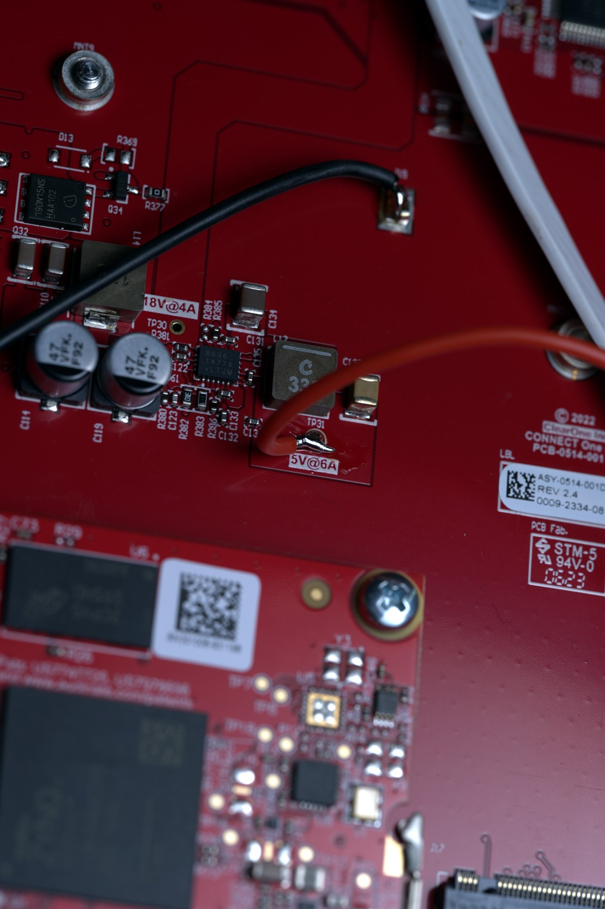
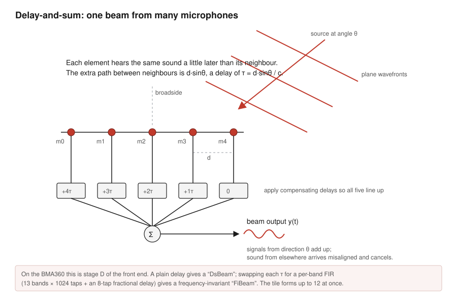

This is the first part of a series on turning a conference-room ceiling microphone into an acoustic camera. Several tiles spread across a yard, each one turning a sound into a bearing, the bearings crossed into a position, the positions over time into a track. The target is birds. The working name around here is the Bird Microphone Array, which is convenient, because the thing is already called a BMA.

The BMA 360D is a ceiling microphone for meeting rooms: a 24-inch square tile, about 5 kg, that drops into a suspended-ceiling grid in place of a normal tile. ClearOne designed it. Biamp announced in October 2025 that it was acquiring ClearOne's IP, brands and product designs, and the unit is sold now as the Biamp BMA 360D. Mine came off the surplus market well before that; the firmware calls the board the BMA360DX, so that is the name I use.

The datasheet is the whole reason it is interesting. Inside the tile are 121 microphone elements. Stock, it forms up to twelve beams at once, puts each beam on its own Dante channel next to an echo-cancelled mix, and reports beam activity over a plain-text TCP port so that a PTZ camera can turn toward whoever is speaking. A box that already points a camera at a talker is most of the way to pointing at a bird.

So the plan looked short: buy a few, read the beams off Dante, cross the bearings on a PC. I thought the tracking math would be the hard part. The hard part turned out to be getting a sample out of the tile at all.

What is actually in the tile
======

I took one apart and read the part numbers off the silicon. There are two separate boards doing two separate jobs, and that single fact set the shape of everything after it.



```
          121-element MEMS disc  (radial spokes)  + a small ring on the main board
                         |  FFC / mezzanine
                         v
   +------------------------------------------------------------------+
   |  MAIN BOARD  (ClearOne)                                          |
   |    Altera Cyclone V 5CEBA9F23C8N   digitize + 121->36 + matrix   |
   |         |  SPI 750 kHz        |  EMIF CS4 0x64000000             |
   |         v                     ^                                  |
   |    ADSP-2156x SHARC+  x9      |   beamforming / AEC              |
   |         ^                     |                                  |
   |    TI OMAP-L138E (ARM926 + C674x, 372 MHz)  Linux 2.6.37        |
   |      NAND 512 MB   eMMC 8 GB   Marvell 6-port GbE switch         |
   |      UART J8 "Linux 115200"    USB LAN (eth1)                    |
   +-----|------------------------------------------------------------+
         | mezzanine (card edge)
         v
   +------------------------------------------------------------------+
   |  BROOKLYN-3 Dante card (Audinate)                                |
   |    Xilinx Zynq-7000 XC7Z015   Dante network interface            |
   |    its own QSPI flash, its own Linux, 8x SDI TDM in              |
   +------------------------------------------------------------------+
```

Two things to take from that diagram.

First, there are two FPGAs in the parts list, and only one of them is in the audio path. The Cyclone V on the main board does the microphone front end, the 121-to-36 fold, and the routing matrix. The Zynq on the Brooklyn-3 card is a Dante network interface and nothing more; it takes finished audio over a card-edge TDM bus and puts it on the wire. All of ClearOne's signal processing lives on the main board, on the Cyclone and on the SHARCs. I spent a while assuming the Zynq was where the action was. It is not.

Second, the OMAP runs Linux, but the audio never touches it. There is no sound card:

```
board$ cat /proc/asound/cards
--- no soundcards ---
board$ cat /proc/interrupts | grep spi_davinci
   (spi_davinci.1 ... 0)
```

Zero interrupts on the audio SPI, because the OMAP is a control plane. It loads code onto the DSPs and pokes the FPGA; the samples go mic -> Cyclone -> SHARC -> Brooklyn-3 and never enter a Linux buffer. There is nothing to `arecord`. That one `cat` killed the easy version of this project.

Where the microphones go
======

Piecing the front end together from the Cyclone image and the kernel driver, front to back:

```
[A] 121 MEMS on a TDM bus, 24-bit, 48 kHz
[B] 121 -> 36 time-multiplexed pre-combine        <- the raw per-mic data stops here
[C] 13-band FIR bank, 1024 taps each
[D] per-beam weights + 8-tap fractional-delay (the actual beamforming)
[E] routing/gain crosspoint matrix
[F] 24 -> 16 bit reduction
[G] 36-slot TDM out -> 8 lanes -> Brooklyn-3 -> Dante
```

Stages C and D are the beamformer — the step that turns 121 microphones into one steerable pickup. The principle is delay-and-sum, and it is the reason an acoustic camera needs the *raw* elements rather than a finished channel:



Stage B is where the short plan died for good. The 121 microphones are folded down to 36 channels inside the Cyclone before anything downstream can see them. Raw per-element audio exists only on the main board, up in the FPGA and the SHARC side. An acoustic camera wants the raw elements — that is the aperture you beamform with — and the product is built specifically to never let them off the tile.

It gets worse before it gets better. A later measurement showed that of the 121 elements, the shipped bitstream only carries mics 1-96 and mic 121; mics 97-120 are silent. Twenty-four elements of aperture are switched off in firmware. That is a Part 4 problem.

The debugging reason this matters
======

When a bearing eventually comes out wrong — and it will — I need to know which stage lied: the microphones, the fold, the SHARC channel order, the FPGA route, the Dante mapping, or my own code on the PC. "The BMA360 sent it" narrows nothing. The entire series is really about earning the ability to put a probe between any two of those stages, on hardware that was designed to be a sealed appliance.

None of this points at a bird yet. The next part is the part the sealed appliance fights hardest: getting a console, and booting a kernel that answers to me instead of to the vendor's startup script.
