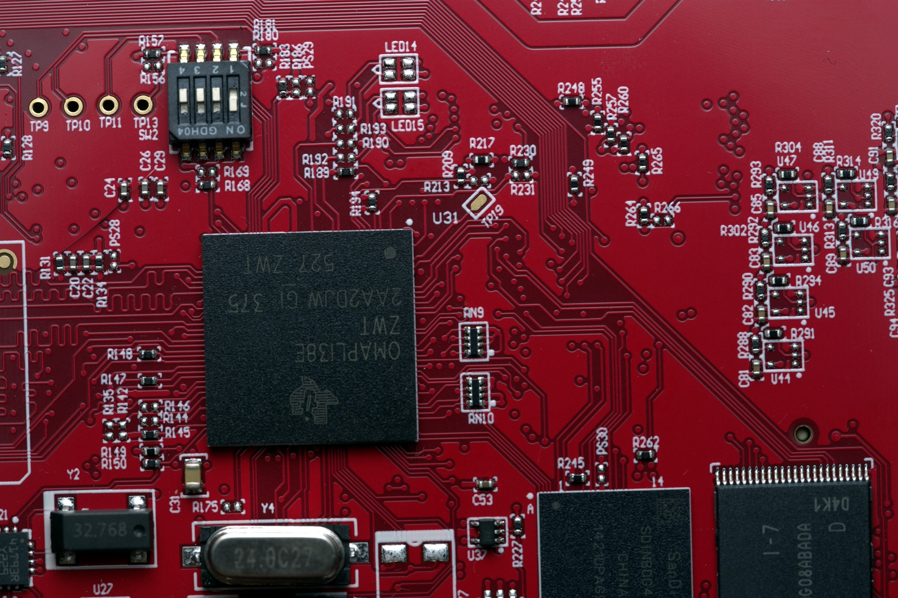

Part 1 ended with a problem: the audio never enters Linux, so there is nothing to record from userspace. Before I can do anything about that I need a way in — a shell on the OMAP that I control, and eventually a kernel of my own choosing. This is that part: serial console, the boot chain, a network-booted root that changes nothing on the device, and finally a kernel written into flash with the factory's own recovery image kept intact as a fallback.

The header
======

The main board has a 4-pin 0.1" header silkscreened `J8` and, next to it in the vendor's own board notes, the string `Linux 115200`. That is the giveaway. A 3.3 V USB-UART dongle on `J8`, 115200 8N1, and the board talks on power-up. (There is a second header `J6` at 57600; that one is the RS-232 management port, not the Linux console.)

What comes out is a TI boot chain, three stages deep before Linux even starts.



The boot chain
======

```
ROM boot ROM
  -> UBL 1.65_3_c1       TI AIS loader, "TIPA", loads to 0x80000000     [NAND @0x20000]
     -> U-Boot 2010.12   (Jul 2016), entry/load 0xC1080000             [NAND @0x40000, kept in triplicate]
        -> bootcmd: run nandimage
           -> kernel-normal (uImage, gzip)                             [NAND @0x200000]
              -> initramfs = cpio LINKED INTO the kernel  (noinitrd, no root=)
                 -> /sbin/init -> rc5.d startup -> heb_app.bin
```

The first-stage UBL identifies itself on the wire:

```
Booting TI User Boot Loader
UBL Version: 1.65_3_c1
Valid magicnum, ... found in block
Valid boot image found!
Starting NAND Copy...
Jumping to entry point
```

Then U-Boot, and this is the stage that matters, because U-Boot has a prompt and a three-second window to grab it. Dumping its environment is the single most useful thing you can do on this board:

```
bootcmd    = run nandimage
nandimage  = run nandimage1; run nandimage2
nandimage1 = run nandargs; nand read ${loadaddr} ${kern_nandoffset} ${imagesize}; bootm ${loadaddr}
nandimage2 = run nandargs; nand read ${loadaddr} ${kernsafe_nandoffset} ${imagesafesize}; bootm ${loadaddr}

loadaddr         = 0xc0700000
kern_nandoffset  = 0x200000      imagesize     = 0xC45808
kernsafe_nandoffset = 0x4220000  imagesafesize = 0x9fc82c
bootdelay = 3    baudrate = 115200
nandargs: console=ttyS2,115200n8 noinitrd rw mem=32M@0xc0000000 mem=188M@0xc4400000 \
          rdinit=/sbin/init ip=none emmc=${emmc} eth=${ethaddr}
flags: KERNELBOOT=1  MFG_MODE=FALSE  SKIP_APP=1
ver = U-Boot 2010.12-00000-gadf5366 (Jul 20 2016 - 16:29:05)
```

Read `bootcmd` closely. `nandimage` runs `nandimage1` and then `nandimage2`. The first boots the normal kernel at `0x200000`; the second boots a *safe* recovery kernel at `0x4220000`. The fallback is **sequential, not conditional**: `nandimage2` only runs if `bootm` of the first image *returns*. A kernel with a bad header falls through to the safe one. A kernel that boots and then hangs does not — `bootm` never returns, and you are stuck. Worth knowing before you write anything into the primary slot.

Two more quirks from that env. `console=ttyS2`/`ttys2` — the lowercase form is what every working vendor script uses, and it is not a bug. And `emmc=` with an *empty value* is mandatory: that empty argument is what makes the kernel register the MMC controller. Leave it off and the eMMC never appears.

The map before you touch anything
======

Before writing to flash I pulled the partition tables. NAND is 512 MB:

```
mtd  name           offset      size   content
 0   u-boot env     0x0         128K   env vars, bootargs
 1   UBL            0x20000     128K   first-stage loader
 2   u-boot         0x40000     512K   U-Boot 2010.12
 3   u-boot env2    0xC0000     1.1M   backup env
 4   kernel-normal  0x200000    32M    primary kernel (imagesize 0xC45808)
 5   Rsvd1          0x2200000   32M
 6   kernel-safe    0x4220000   32M    recovery kernel (imagesafesize 0x9fc82c)
 7   FileSystem     0x6220000   32M    all 0xFF (empty)
 8   Rsvd2          0x8220000  ~382M
```

The rootfs is not here. It is a `cpio` archive linked straight into the kernel image — `noinitrd`, no `root=` on the command line, `rdinit=/sbin/init`. The 8 GB eMMC holds the application, config and logs, not the init root:

```
mmcblk0  partitions
 p2 /fwsys   4M   runtime flags
 p3 /fwbin   2G   app + kernel + firmware blobs
 p5 /fwdata  2G   config / live state
 p6 /fwlog   1G   syslog
 p7 /fwsync  1G   staging for over-the-air updates
```

`/fwsys` was a small surprise worth repeating: its flags are *file presence*, not file contents. A file named `MASTER` or `updateflag.fpga` existing is the signal; what is inside it is irrelevant.

Booting a root that changes nothing
======

The first real foothold does not write to the device at all. Interrupt U-Boot, point the kernel at an NFS root exported from the bench machine, and boot. The device flash is untouched and the whole thing is reversible with a power cycle:

```
setenv serverip <bench-ip>
setenv ipaddr   <board-ip>
setenv bootargs console=ttyS2,115200n8 noinitrd rw \
    mem=32M@0xc0000000 mem=188M@0xc4400000 \
    root=/dev/nfs nfsroot=<bench-ip>:/srv/rootfs,nolock \
    ip=<board-ip>:<bench-ip>::255.255.255.0::eth0:off \
    emmc= eth=<board-mac>
nand read 0xc0700000 0x200000 0xc45808
bootm 0xc0700000
```

Export a root that is the stock userland plus the `c1*` kernel modules plus my own tools, and the board boots into it over the network. One trap cost me an afternoon: copy the factory `lib/` across too (glibc 2.9, the `ld-linux.so.3` symlinks), or every vendor binary dies with `ENOENT` at exec — not because the binary is missing, but because its loader is.

With an NFS root I have a shell, my own tools on `PATH`, and the device's own flash exactly as the factory left it. This is the point where it stops being an appliance.

A kernel that persists
======

NFS root is a bench setup. To carry a modified kernel on the tile itself I write it into the primary NAND slot and leave the safe slot as a parachute. The order matters:

```
# 1. Save a known-good stock kernel FIRST, through the MTD driver so ECC is applied --
#    NOT a raw nanddump, which copies uncorrected bytes.
board$ dd if=/dev/mtd4 of=/fwsync/uImage.stock bs=131072

# 2. At U-Boot: erase the primary slot and write the new kernel.
nand erase 0x200000 0x2000000
nand write 0xc0700000 0x200000 <filesize>

# 3. If the image size changed, fix U-Boot's recorded length or bootm reads the wrong count.
fw_setenv imagesize <hex-filesize>
```

The safe kernel at `0x4220000` is never touched, so `bootcmd` still tries normal, then safe. Reverting is re-writing `uImage.stock` the same way. Always prove the new kernel over TFTP first — `tftp 0xc0700000 uImage.new; bootm` — because of the sequential-fallback trap above: a kernel that hangs after a successful `bootm` will not fall through to the parachute.

That is the whole recovery posture. One NFS path that touches nothing, one flash path that keeps the factory's own recovery image intact, and a serial console to watch both. On a board I own, that is just ordinary bring-up — but on an appliance that expects to only ever run `heb_app.bin`, it is the difference between a research platform and a paperweight.

There is a second computer in the tile, though, and it boots its own Linux over a connector I had written off as dark. That is Part 3.
