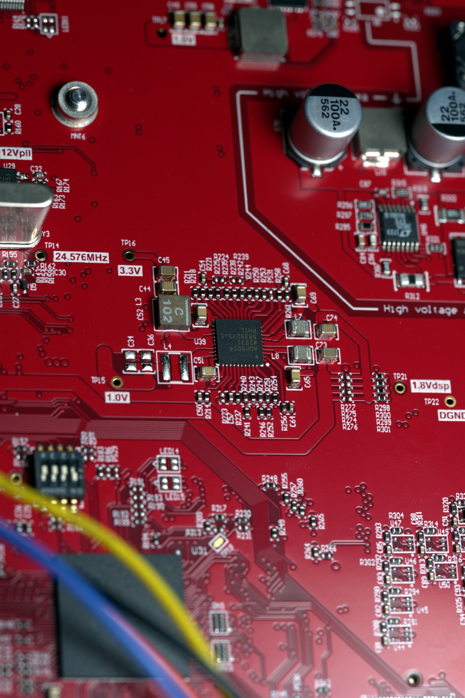

The audio lives on the TDM buses, and the chips sitting on those buses are the SHARC+ DSPs (ADSP-2156x). If I want samples, I have to run my own code on one. This part is how I got there, including a wrong belief I held for weeks.



The DSPs were never dead
======

For a long time my notes said "most DSPs don't come up." That was wrong — and fixing the belief changed my whole approach. When the stock application loads them, **all eight DSPs load and identify** — they answer the identify exchange with their expected IDs (…0002… through …0009…). A full nine-DSP load from empty was later confirmed on hardware with my own loader too: 52 seconds, 41 of 41 identify soak passes.

So the DSPs were fine. What was broken was *my* loader — the hand-driven one I was poking words with. The failure was in my tooling, not the silicon. "The hardware is broken" is the most expensive wrong call there is, and I made it.

The loader that segfaulted on a string
======

The vendor loader is a Linux program that reads an `.ldr` image and clocks it into a DSP over SPI. Running it standalone, it segfaulted. The `.ldr` format is simple enough — 16-byte block headers, each carrying a target address, a word count, and a type:

```
LDR BLOCK HEADER (16 bytes)
  +0  u32  block code (type in low byte: 0x04 final, others init/zero/data)
  +4  u32  target address (DSP memory)
  +8  u32  byte count
  +12 u32  argument / next
```

The crash was not in the format. It was in a sanity check the loader does *before* it ever touches the DSP: `getPCBAssembly()` reads a board-info string and `strncmp`s it against `"ASY-0514"`. On a bare bench rig that string is not where the loader expects, so the compare walks off a null pointer and the process dies. The DSP never even gets clocked.

The fix is twelve bytes. The trap is that patching a file offset is not the same as patching a virtual address — the loader is mapped with a base, so the byte you want to change at file offset `N` lives at vaddr `N + 0x8000`:

```
PSEUDOCODE -- neutralize the board-ID gate
  file_offset = <offset of the strncmp branch>
  vaddr       = file_offset + 0x8000        # mapping base, NOT a 1:1 patch
  # replace the conditional branch with an unconditional "assembly OK"
  patch 12 bytes at vaddr so getPCBAssembly() returns match
```

With the gate neutralized the loader runs to completion on the bench. But "runs to completion" is not "the DSP accepted it," which is the next wall.

The handshake you have to read, not assume
======

The SHARC load is clocked over SPI at 750 kHz in 4-byte words, and there is a readiness handshake. My first instinct — clock the whole image as fast as the bus allows — produced a DSP that loaded but did not identify. The reason is that readiness is not a single pin you can poll once; it is a per-DSP bit, and the loader is supposed to wait on the right one.

On the FPGA side there is a DSP-ready register at CS4 offset `0x10E`. Its encoding is backwards from the obvious reading, and I only got it right by watching it change:

```
REGISTER 0x6400010E  -- DSP readiness bitmap
  bit N SET   => DSP N is NOT ready        (inverted sense)
  bit N CLEAR => DSP N ready
  the "not ready" bits LATCH; you read, you don't get a live level
  observed sweep as DSPs come up: 0x007F -> ... -> 0x03FF
```

Reading a latched, inverted bitmap as if it were a live active-high "ready" line is exactly the kind of thing that makes you clock data into a chip that is not listening. The reset/done split at `0x114` is the same shape — write side resets, read side reports SPI-done — two different meanings on one address. Once I waited on the correct cleared bit per DSP before sending its blocks, loads identified every time.

At this point I replaced the patched vendor loader entirely with my own, `sharcload`: it does the block walk, the per-DSP readiness wait, and read-back verification itself. The vendor binary is no longer in the path. The milestone isn't the patch; it's that I own the load now.

My instructions, executing
======

The last step is proving my own code runs, not just that the chip accepted a vendor image. The lever is a single word in instruction memory.

Inside the running DSP4 there is an interrupt service routine. At one address it holds the instruction `0x00251002`. Overwriting that one word with `0x0018063e` redirects execution into a short routine of mine — and I can prove it took, because the ISR counter keeps advancing (≈6000/s) with my word in place, and writing it back restores the original value and behavior:

```
one-word ISR hook on DSP4
  addr(ISR) :  0x00251002   <-- stock instruction
  write      :  0x0018063e   <-- my hook; ISR rate stays ~6000/s (it ran, didn't hang)
  rollback   :  0x00251002   <-- restored; identical behavior returns
```

That round-trip — change one instruction, observe the running system react, put it back exactly — is reversible, observed live, and it is my code on their DSP. As a control, I used the same hook to flip a SPORT chip-select word (`0x3100208C`) from `1` to `0x001FFFFF` and read it back changed, then rolled it back: before `00000001`, after `001fffff`, restore `00000001`. The hook does what I say.

![A diagram of the sharcload pipeline in five stages — parse the .ldr block headers, pass the board-ID gate, clock over SPI at 750 kHz, wait per-DSP on the readiness register, then verify and identify — with the two walls called out: the board-ID strncmp that segfaults before the DSP is ever clocked (fixed by a 12-byte patch at vaddr = file_offset + 0x8000) and the inverted, latched readiness register 0x6400010E where a set bit means NOT ready. Below, the reversible one-word ISR hook on DSP4: stock 0x00251002, overwritten with 0x0018063e while the ISR rate stays ~6000/s, then rolled back bit-for-bit.](/images/BMA360_sharc_load_handshake.svg)

What I own now
======

I can load any of the DSPs with my own loader, verify the load, and execute my own instructions inside a live ISR, reversibly. What I do **not** have yet is a microphone sample in my hands — the hook proves control, not capture. Getting one frame of audio out of DSP4's receive ring, and the index register that lied to me for a week while I did it, is Part 6.
