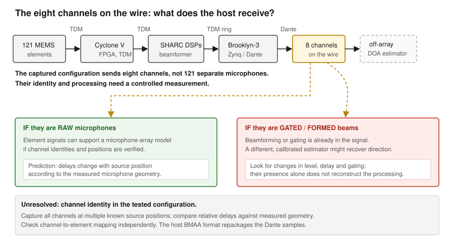

By now the array gives up register access, level meters, loadable DSPs, my own code in an ISR, and a frame of real microphone audio copied out of DSP4's ring. The obvious finish line is: point it at birds and read bearings off the eight channels it sends on the wire. This part is why I stopped short of that finish line on purpose.

Eight channels, and the only question that matters
======

A conference-phone ceiling tile is designed to combine microphones into voice pickups. In the configuration I captured, the Dante output contains eight channels, not 121 separate microphone streams. The unresolved question is what processing those eight channels have already undergone.


The distinction changes the model a direction estimator can use:

```
If the 8 channels are individual microphone signals:
   measured element positions and delays -> an off-array beamformer is possible

If they are processed beams:
   the aperture and any gating are already part of the signals
   -> a raw-microphone model is inappropriate
   -> a different, calibrated estimator might still extract direction
```



The host's current estimator assumes microphone positions. If its inputs are already processed beams, its geometry and delay predictions need a different justification.

What the existing evidence says
======

One project status description calls the Dante output eight processed or gated beams and says raw ungated audio is unavailable on that path. The host direction-estimation path describes its input as an eight-microphone stream. Those descriptions do not establish that the same physical signals are being discussed: an estimator's input assumption is not a measurement of the card's output.

For the configuration being tested, the honest label is **eight Dante channels of unresolved identity**. The Windows bridge repackages those samples into a separate host format called BMAA; it does not turn them into raw microphones.

What a capture would have to show
======

The test needs synchronized captures from all eight channels and a source whose positions are measured. Keep routing, gains, and any automatic processing fixed and recorded. Use a broadband signal at two or more known bearings and include silence:

```
1. Capture all eight channels with the source silent, then at each position.
2. Compare relative channel levels and cross-correlations at each position.
3. If testing a microphone model, predict delays from measured element
   positions and compare them with the captured delays.
4. Repeat with level changes; look for gating, gain changes, and dropouts.
5. Record the board configuration alongside the capture and the result.
```

Neither correlated channels nor a lack of visible gating proves that a channel is raw. A match to the microphone-delay model would support that model under the tested conditions; identifying the exact routing still requires an independent channel-to-element check. A mismatch or gain pumping would be evidence of processing, not a complete reconstruction of it.

The other loose ends on the wire
======

Two more measured oddities belong here, flagged as unresolved rather than explained:

- There is a consistent sample lag on the order of 602–603 samples between references I expected to line up. I have the number; I do not yet have a confirmed cause, so I am not going to invent one.
- The hub can process per-array tracks and attempt fusion, but that is not a validated two-array fix. One November 19 fleet snapshot had two arrays, 42 bearing rays, and zero fused tracks (Part 9).

The lag has no settled explanation; a running hub with no fused track is a status observation, not an explanation for why fusion did or did not happen.

What this part does not claim
======

To be explicit:

> I have **not** shown that the eight Dante channels are raw microphones. I have **not** produced a validated direction-of-arrival from live array audio. I have **not** tracked a bird. What I have is eight channels of unknown-but-knowable content, a concrete experiment to identify them, and two unexplained measurements I am refusing to paper over.

Part 8 follows the experimental one-wire link and explains what the simulated bearing map can test. Part 9 follows the audio that already leaves the tiles over Dante, through the hub and into the web dashboard.
