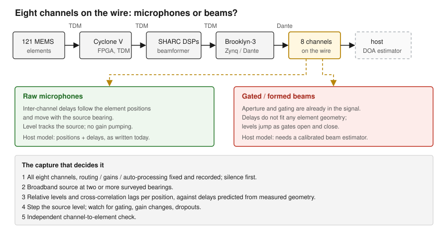
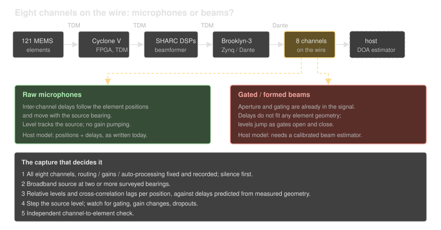

By now the array gives up register access, level meters, loadable DSPs, my own code in an ISR, and a frame of real microphone audio copied out of DSP4's ring. The obvious next move is to point it at birds and read bearings off the eight channels it sends on the wire. I stopped short of that.

Eight channels
======

A conference-phone ceiling tile combines microphones into voice pickups. In the configuration I captured, the Dante output has eight channels, not 121 microphone streams. What processing those eight have already been through is the open question.


{: .only-light}
{: .only-dark}

The two sources disagree. One project status description calls the Dante output eight processed or gated beams and says raw ungated audio is not available on that path. The host direction-estimation code describes its input as an eight-microphone stream and models microphone positions. An estimator's input assumption is not a measurement of the card's output, so for the November 3 captures these are **eight Dante channels of unresolved identity**. What the channels carry depends on how the card's input matrix is routed: my later notes (November 14) find the matrix inputs that carry the raw rim microphones and routed the channels that way, so the identity is a matter of configuration, and these stock-configuration captures do not show which one was in force. The Windows bridge repackages the samples into a host format called BMAA; it does not turn them into microphones.

What the packets look like
======

I went back to three short Dante captures of one tile from November 3, stock firmware and stock configuration. The audio sits in UDP packets to port 4321, 393 bytes each:

```
0x02 | seconds (u32 BE) | frame (u32 BE) | 16 frames x 8 ch x s24 BE
  1          4                  4                  384
```

The frame counter steps by 16 per packet. The card sends two transmit flows (in capture C they sit six frames apart; the offset differs between captures), and on every overlapping sample they carry the same eight channels bit for bit. Decoded, de-duplicated and ordered, that gives 0.07 s, 0.62 s and 0.24 s of ambient room sound, no controlled source:

{: .only-light}
{: .only-dark}

{: .only-light}
{: .only-dark}

No channel is ever exactly zero, so nothing gated shut during these windows. Correlation falls off smoothly with channel distance and the peak lag drifts by a few samples across the index. A ring of microphones would do that. So would eight overlapping beams steered around a circle. Without a source at a known bearing these captures cannot tell them apart.

An ambient-event fit
======

There is something between "no geometry" and "measured microphone map." I fit the relative delays among the eight Dante channels for ambient-event slices, at 48 kHz with sound speed taken as 343 m/s. The filter kept 86 of 1,033 events for one tile and 60 of 640 for the other: under one sample RMS closure error across all 28 channel pairs, and a minimum normalized pair peak above 0.08. The kept delay patterns fit a circle with RMS residuals of 0.705 and 0.537 samples.

That gives a ring-like *relative* channel geometry under the model. It does not say which physical microphone is slot 0, the circle's rotation or reflection, or the Dante routing. The radii, about 261 mm and 256 mm, come from treating the 99th-percentile delay amplitude as an in-plane arrival, so a source above or below the plane shrinks them.

Fitting both tiles together lands on two layouts at once:

{: .only-light}
{: .only-dark}

Every fit statistic is the same for both. This data and objective cannot choose between the mirror images, and no source at a surveyed bearing has picked one yet. The event counts and fit statistics come from recorded delay arrays that are not published here.

Two loose ends
======

Separately, in my array-to-array commissioning notes there is a consistent lag of 602 to 603 samples between two arrays' streams that I expected to line up. It is an inter-array offset, not something inside one tile's eight channels. I have the number and no confirmed cause.

The hub can process per-array tracks and attempt fusion. One November 19 fleet snapshot had two arrays, 42 bearing rays and zero fused tracks (Part 9).

No bird has been tracked yet, and no bearing has come from live array audio. Part 8 is the simulated bearing map and the one-wire link I am building to get samples out without Dante. Part 9 follows the Dante audio that already leaves the tiles, through the hub and into the web dashboard.
