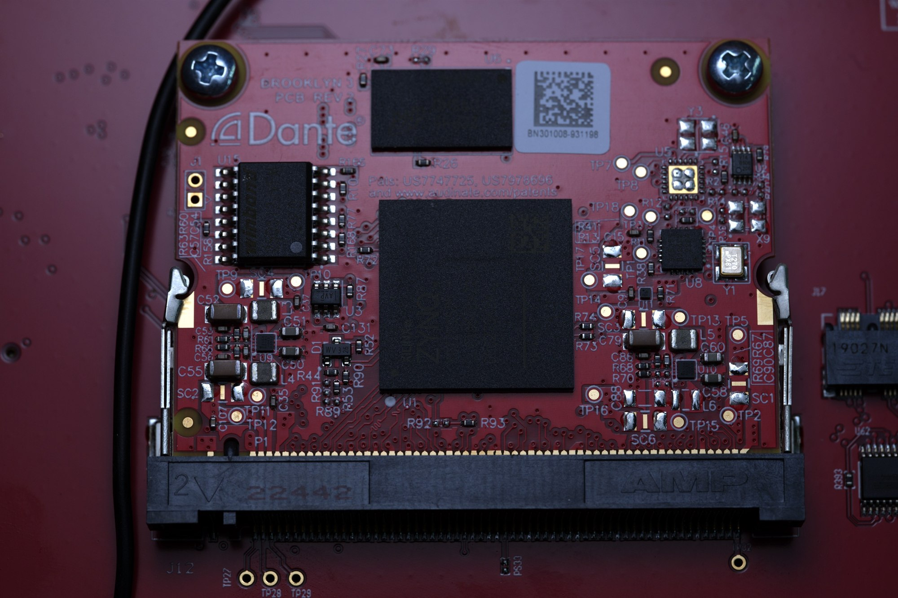

By now the array gives up register access, level meters, loadable DSPs, my own code in an ISR, and a frame of real microphone audio copied out of DSP4's ring. The obvious finish line is: point it at birds and read bearings off the eight channels it sends on the wire. This part is why I stopped short of that finish line on purpose.

Eight channels, and the only question that matters
======

A conference-phone ceiling tile does not stream 121 raw microphones. It runs its beamformer and sends a handful of *processed* channels — the design's whole job is to collapse 121 elements into a few clean voice pickups. The BMA360's output is eight channels.



For an acoustic camera, the difference between the two things those eight channels could be is the difference between a usable instrument and a toy:

```
If the 8 channels are RAW microphones:
   8 element signals -> I can run my own beamformer off-array -> real DOA possible

If the 8 channels are GATED/FORMED beams:
   8 fixed voice beams, auto-mixed/gated for speech -> directionality is
   already baked in and thrown away -> NOT raw aperture, DOA is not mine to do
```


Everything downstream — whether I can do direction-of-arrival at all — hinges on which of those it is. So I went looking for the answer in the firmware.

The firmware contradicts itself
======

Here is the part I cannot close out. On the same checked-out master snapshot, two files in the audio daemon describe the eight-channel input differently:

```
bench-kit/bma-audiod/STATUS.md   (dated 2026-10-27):
    "the Dante feed is eight processed/gated beams;
     raw ungated audio is NOT available over Dante"

bench-kit/bma-audiod/docs/fleet.md:
    describes the DOA stand-in input as an "eight-microphone stream"
```

One says gated beams. The other says microphones. These are not the same claim, and I cannot tell from the source tree alone which describes the hardware and which describes a convenient development stand-in. It is entirely plausible that `fleet.md` is talking about a synthetic eight-mic test source feeding the DOA code, while `STATUS.md` describes what the real Dante card actually emits — but "plausible" is not "measured," and I am not going to publish a bird-tracking result built on a guess about my own input.

So the honest label, which I will keep using until a packet capture settles it, is: **the tile emits an eight-channel BMAA/Dante feed of unresolved content.** Not "eight raw microphones." Not "121-channel raw audio." Eight channels, identity to be determined by measurement.

What a capture would have to show
======

Resolving this is not hard in principle, it just requires the measurement I have not finished. A real packet capture at the tile, with a controlled stimulus, would distinguish the two cases:

```
TEST: play a single source from a known bearing, capture all 8 channels.

  RAW-microphone signature:
    - inter-channel delays consistent with element geometry (a few samples,
      direction-dependent); move the source -> delays change predictably
    - broadband, no auto-gain pumping, no gating dropouts

  GATED-beam signature:
    - channels are near-copies with fixed, small inter-beam differences
    - auto-mixer behavior: level jumps, gating, one channel "winning"
    - moving the source does NOT produce clean geometric delay shifts
```

Until I have run exactly that, the channel identity stays open. I would rather ship a post that says "I don't know yet, here's how I'll find out" than one that quietly assumes the convenient answer.

The other loose ends on the wire
======

Two more measured oddities belong here, flagged as unresolved rather than explained:

- There is a consistent sample lag on the order of 602–603 samples between references I expected to line up. I have the number; I do not yet have a confirmed cause, so I am not going to invent one.
- The fusion/tracking stage in the current code is **off**. Whatever the downstream path does today, it is not running end-to-end fusion on live array data.

I am listing these because leaving them out would make the system look more finished than it is. They are real observations with no settled explanation, which is a different category from the mechanism results in Parts 5 and 6.

What this part does not claim
======

To be explicit:

> I have **not** shown that the eight Dante channels are raw microphones. I have **not** produced a validated direction-of-arrival from live array audio. I have **not** tracked a bird. What I have is eight channels of unknown-but-knowable content, a concrete experiment to identify them, and two unexplained measurements I am refusing to paper over.

Part 8 is the last one: where the bearings actually come from today (simulation), the one real transport I built to get a single wire of data out of the array, and a plain list of everything between here and a working acoustic camera.
