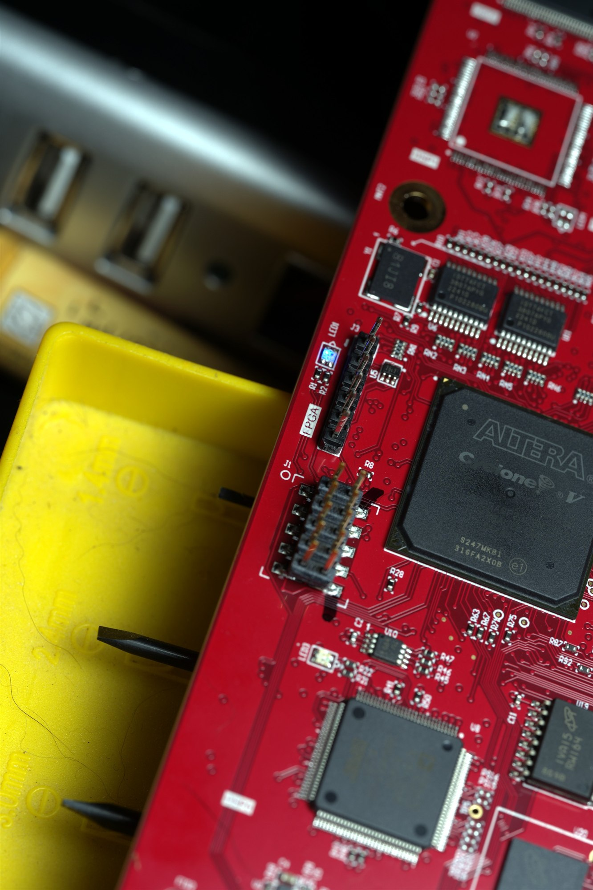
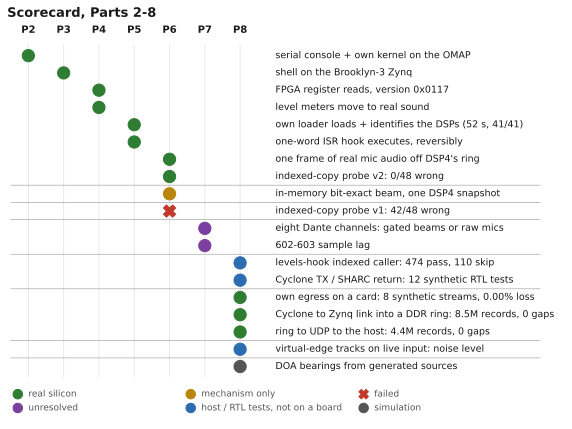

The hub already gets live audio from both tiles over Dante (Part 9). This part covers two things built next to that: a bearing estimator, and a single wire to pull audio straight off the Cyclone.



Bearings
======

The bearing map is a DOA estimator fed generated signals, so I can check it against inputs where I already know the angle:

```
generated signal --> DOA estimator --> hub display --> bearings on a map
```

{: .only-light}
{: .only-dark}

I also pointed a host-side "virtual edge" at the live raw-mic streams. With nothing in the room to track it produced noise-level tracks with a median length of about two seconds. The next run needs a speaker at a measured position.

bma_egressd
======

On the stock image the Zynq's PL packetizes audio somewhere the processor can't read, so I wrote my own egress daemon, `bma_egressd`, with pluggable sources:

```
bma_egressd sources:
  synthetic   -> framing/transport tests
  zynq-pl     -> PL ring reader; the ring now fills from the Cyclone link (below)
  omap-emif   -> not written
```

The synthetic source has run on a card. I started `bma_egressd` from RAM on board A's card, under the vendor kernel, broadcasting eight synthetic streams to a receiver on my PC. The receiver saw the array announce itself with eight streams and logged 0.00% loss (from the same one-off run, so also unreproduced). That covers the framing and the transport on real hardware. It says nothing about microphone audio. The egress code also has an adaptive mode, up to 64 output streams with a default of 32, that re-steers beams toward a tracker's targets between reads. It is in the source on master. I haven't tested it, and it has not run on a board with microphone audio.

It also appeared to show where the card's CPU goes, but this part is unreproduced: it comes from one bench run for which I have found no saved log, so I have removed the exact counts (interrupt rate, log size, skipped-frame totals, and the date). What I recall is that with the vendor stack up the CPU was saturated, `ipcore_manager` took most of it, the vendor control link kept logging lost syncs on a stream of `0x00` bytes, and the daemon skipped frames to stay on time. With `ipcore_manager` paused the CPU had headroom and the eight streams ran without skipped frames. Treat that as a lead to re-measure, not a result.

{: .only-light}
{: .only-dark}

The host side already has a real-audio checker and a listen mode, both tuned on vendor-path mic audio, so whatever comes out of the custom source gets judged the same way.

The one wire out
======

The only Cyclone-to-Zynq net anyone has measured is the Cyclone's R9 pin landing on the Zynq's W13, so the link is one wire. LINK1W v1 is Manchester at one cell per 24.576 MHz clock, one frame per 48 kHz tick, eight 24-bit words:

{: .only-light}
{: .only-dark}

The preamble is three cells high and three low. No Manchester data can hold a level for three cells, so the receiver can't mistake data for a frame start. The header carries version 1 and the word count, and the CRC-8 (poly 0x07) covers header and words. The receiver takes its cell period from the idle run, which is why every frame needs a lead-in.

Here is the transmitter RTL in Icarus, fed the `ramp8` fixture (words 1, -1, 0x7FFFFF, -0x800000, 0x123456, 0, 2, -2):

{: .only-light}
{: .only-dark}

All 483 cells match the reference model's checked-in vector. The Zynq receiver and image top pass RTL and open-flow checks. The Cyclone transmitter and the SHARC return block pass their Icarus simulations on synthetic fixtures. Since then the link has run on boards. The Zynq receiver writes records into a DDR ring. One run on board B captured 8,509,310 records with no gaps, no duplicates and no CRC violations. A small program on the card sends the ring out as UDP, and a 4.4 million record capture arrived with no sequence gaps. Board C's Cyclone runs my own image and its ring runs too. A host bridge feeds the ring into the hub's eight-slot path, and the dashboard shows a waveform.

Measured against my host PC's clock over 150 seconds, the two cards' frame counters advance at 48,010.71 records a second (board B) and 48,010.39 (board C), about 220 ppm above 48 kHz (one run, host-clock-relative, absolute uncertainty about 10 Hz). Those numbers are relative to the host clock, which is not disciplined by PTP or GPS, so the absolute rate is only good to about 10 Hz and the 220 ppm may partly be my PC's crystal. Board B and board C cannot be told apart at roughly 20 ppm, and the 0.3 Hz difference between them comes from a single run. The transmitter sends one frame per 512 Cyclone audio-clock edges, so 24.576 MHz would give exactly 48 kHz; I would not read this as a measured clock error, since one run against an undisciplined host clock cannot separate the two. Which clock, if any, is off, I haven't identified. An earlier 48.7k figure had no measurement behind it, and I removed it.

What the ring carries is not yet shown to be microphone audio. The eight lanes correlate at 0.92 to 0.98 and a tone near 103 Hz dominates. Which microphone is which lane is not mapped. A lane-map search against the measured 121-microphone layout was inconclusive and leans toward a fixed skew per lane. Records are eight lanes, not 32 or 64 streams, and Dante is not in this path.

A script flashes the Cyclone, arms the link, starts the sender and registers a watchdog. The ring-enable step is lost on a power cycle, and the script's cold-start run is still to do.

Replaying one capture through the hub's estimator, 91.7% of windows failed the coherence gate and 5.6% produced a bearing. Those bearings are not evidence of direction.

GNU Radio
======

I wrote a GNU Radio 3.10 module, `gr-bma360`, in Python with no C++ build. It reads the ring's UDP stream, decodes the hub's metadata packets and estimates pairwise lane delays with GCC-PHAT. It also exports a capture to SigMF and back byte for byte, and bridges lanes and metadata over ZeroMQ.

The module has 148 host tests (kernels, ZeroMQ loopback, the fake-API wrappers, flowgraph YAML checks and a package check), with real loopback sockets for the ZeroMQ bridge. Replaying one capture of 27,432 packets and 960,120 records gave no lost packets, frame-counter gaps or header mismatches. The SigMF exports validate with the official package. The block wrapper tests still use a fake GNU Radio API. Under a real GNU Radio 3.10.12 install, `grcc` compiles all three example flowgraphs, and the file-replay flowgraph runs to completion on a capture. I have not opened them in the GRC editor.

The bridge also fans out per-lane packets, so the module decodes those too. I first read 150 seconds of the live stream with a standalone numpy script: 1,646,068 packets, 7.2 million samples per lane, no lost packets and no frame-counter gaps. The module itself only replayed that saved capture, through its file source into the delay estimator, in 34 seconds. Its live UDP source has so far only been exercised by the kernel tests.

The delays do not hold still. Across six captures the median correlation peak is 0.08 to 0.09, and at most 4 of the 28 lane pairs keep 80% of their windows within one sample of their median. The lane 0 to 1 lag swings from +3.3 to -7.6 samples between captures. Only lanes 6 and 7 are steady, and the saved live capture shows the same: 2 of 28 pairs steady over 1,500 windows. The lane-map search leans toward a fixed skew per lane, but an earlier onset-estimator test found the lag depends on where the sound comes from, which favours an acoustic cause. The two disagree, so I cannot recover the lane-to-microphone map from this. Lane delays are relative and uncalibrated, and the module is not yet installed into GNU Radio proper.

Scorecard
======

{: .only-light}
{: .only-dark}

The corrected levels hook is merged and host-tested, not loaded on a board; mutating out its scale conversion fails 25 of the host tests. A static review flagged that delayed beam history might survive an epoch change in the egress path. That gets a fix or a test before the combined path goes on a board.

What's left
======

{: .only-light}
{: .only-dark}

Part 9 is the path that runs today: the hub and dashboard on the stock Dante stream.
