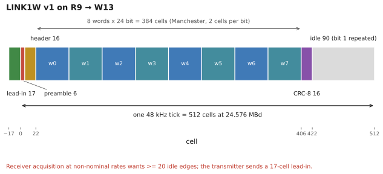
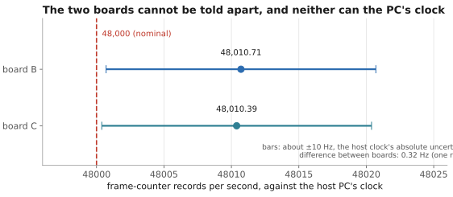
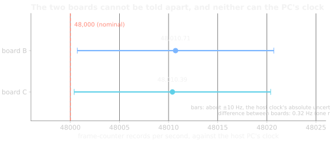

By this point the hub was already getting live audio from both tiles over Dante, which is the subject of Part 9. What I wanted next was two things that the stock path could not give me: a bearing for each sound, and a way to pull audio off the Cyclone without going through the vendor's card at all.


Bearings
======

I started with the estimator, because it is the part I can check without a microphone. A direction-of-arrival estimator fed generated signals has a known right answer, so I built the whole chain around it and made it prove itself on inputs where I already knew the angle:

```
generated signal --> DOA estimator --> hub display --> bearings on a map
```

{: .only-light}
{: .only-dark}

Everything in that picture is simulated. The bearings cross where the generated source sits, and successive fixes form a track, which shows the geometry and the bookkeeping work. It says nothing about real sound.

The first real test was modest. I pointed a host-side "virtual edge" at the live raw-mic streams and let it run with nothing in the room to track. It found tracks anyway, at noise level, with a median length of about two seconds, which is what an estimator does when you give it nothing to find. The next run needs a speaker at a measured position.

An egress daemon of my own
======

On the stock image the Zynq's PL packetizes the audio somewhere the processor cannot read. So I wrote my own egress daemon, `bma_egressd`, with pluggable sources:

```
bma_egressd sources:
  synthetic   -> framing/transport tests
  zynq-pl     -> PL ring reader; the ring now fills from the Cyclone link (below)
  omap-emif   -> not written
```

The synthetic source is the one that has run on a card. I started `bma_egressd` from RAM on board A's card, under the vendor kernel, and had it broadcast eight synthetic streams to a receiver on my PC. The receiver saw the array announce itself with eight streams and logged 0.00% loss. That was a single run and I have not repeated it, so it proves the framing and the transport work on real hardware and nothing about microphone audio. The daemon also has an adaptive mode, up to 64 output streams with a default of 32, that re-steers beams toward a tracker's targets between reads. It is in the source on master, and it has never run on a board with microphone audio.

The same bench session told me something about the card's CPU. With the vendor stack up, the processor was saturated: `ipcore_manager` took most of it, the vendor control link kept logging lost syncs on a stream of `0x00` bytes, and the daemon skipped frames to stay on time. With `ipcore_manager` paused the CPU had headroom and the eight streams ran without skipping. I found no saved log of that session, so I am leaving out the exact counts and treating it as a lead to re-measure, not a number.

{: .only-light}
{: .only-dark}

On the host side I already had a real-audio checker and a listen mode, both tuned on vendor-path microphone audio. Whatever the custom source produces gets judged by the same tools.

The one wire out
======

To fill that custom source I needed a path from the Cyclone to the Zynq. The only Cyclone-to-Zynq net anyone has measured is the Cyclone's R9 pin landing on the Zynq's W13, so whatever I built had to fit on a single wire.

I called it LINK1W. Version 1 is Manchester, one cell per 24.576 MHz clock, one frame per 48 kHz tick, each frame carrying eight 24-bit words:

{: .only-light}
{: .only-dark}

The frame starts with a preamble of three cells high and three low. No Manchester data can hold a level for three cells, so the receiver can never mistake data for a frame start. The header carries the version and the word count, and a CRC-8 (polynomial 0x07) covers header and words. The receiver takes its cell period from the idle run before each frame, which is why every frame has to open with a lead-in.

I ran the transmitter RTL in Icarus, feeding it a `ramp8` fixture of eight words chosen to hit the edges of the 24-bit range: 1, -1, 0x7FFFFF, -0x800000, 0x123456, 0, 2, -2.

{: .only-light}
{: .only-dark}

All 483 cells matched the reference model's checked-in vector. The Zynq receiver and image top passed RTL and open-flow checks, and the Cyclone transmitter and the SHARC return block passed their Icarus simulations on synthetic fixtures.

Then I put it on boards, and it worked. The Zynq receiver writes records into a DDR ring, a small program on the card sends the ring out as UDP, and a host bridge feeds it into the hub's eight-slot path, where the dashboard draws a waveform from it:

| Run | Records | Result |
|---|---|---|
| Board B, receiver into the DDR ring | 8,509,310 | no gaps, no duplicates, no CRC violations |
| Board B, ring sent out as UDP | 4.4 million | no sequence gaps |
| Board C, running my own Cyclone image | — | its ring runs too |

I also timed the two cards' frame counters against my PC's clock over 150 seconds:

{: .only-light}
{: .only-dark}

Both boards read about 220 ppm above 48 kHz, but my PC's clock is not disciplined by PTP or GPS, so the bars are as wide as the whole offset and some of it may be my PC's crystal. The two boards cannot be told apart at roughly 20 ppm, and the 0.3 Hz between them comes from one run. The transmitter sends one frame per 512 Cyclone audio-clock edges, so a 24.576 MHz clock would give exactly 48 kHz, and one run against an undisciplined clock cannot say which clock, if either, is off. I am not calling this a clock error.

What I cannot yet say is what the ring carries. It is not yet shown to be microphone audio. The eight lanes correlate with each other at 0.92 to 0.98 and a tone near 103 Hz dominates. I have not mapped which microphone is which lane, and a lane-map search against the measured 121-microphone layout was inconclusive, leaning toward a fixed skew per lane. These records are eight lanes, not the 32 or 64 streams of the egress daemon's adaptive mode, and Dante is not in this path at all.

A script now flashes the Cyclone, arms the link, starts the sender and registers a watchdog. The ring-enable step is lost on a power cycle.

I also replayed one capture through the hub's estimator. 91.7% of the windows failed the coherence gate and 5.6% produced a bearing, and those bearings are not evidence of direction.

GNU Radio
======

To look at the ring's stream with better tools than my own scripts, I wrote a GNU Radio 3.10 module, `gr-bma360`, in Python with no C++ build. It reads the ring's UDP stream, decodes the hub's metadata packets and estimates pairwise lane delays with GCC-PHAT. It exports a capture to SigMF and back byte for byte, and it bridges lanes and metadata over ZeroMQ.

The module has 148 host tests covering the kernels, a ZeroMQ loopback with real sockets, the fake-API wrappers, the flowgraph YAML and the package itself. Replaying one capture of 27,432 packets and 960,120 records produced no lost packets, no frame-counter gaps and no header mismatches, and the SigMF exports validate with the official package. The block wrapper tests use a fake GNU Radio API, so I also checked against a real GNU Radio 3.10.12 install: `grcc` compiles all three example flowgraphs, and the file-replay flowgraph runs to completion on a capture. I have not opened them in the GRC editor.

The bridge fans out per-lane packets, so the module decodes those as well. To check the live stream I first read 150 seconds of it with a standalone numpy script: 1,646,068 packets, 7.2 million samples per lane, no lost packets and no frame-counter gaps. The module itself has only replayed that saved capture, through its file source and into the delay estimator, in 34 seconds. Its live UDP source has so far been exercised only by the kernel tests.

Where the module earned its keep was in showing that the lane delays do not hold still. Across six captures the median correlation peak is only 0.08 to 0.09, and the lag between lanes 0 and 1 swings across the range below. Only lanes 6 and 7 are steady:

{: .only-light}
{: .only-dark}

The lane-map search leans toward a fixed skew per lane, which would make it a property of the hardware. An earlier onset-estimator test found that the lag depends on where the sound comes from, which points to the sound field. The two disagree, so I cannot recover the lane-to-microphone map from this data. A real-audio test against a known bearing would settle it. Until then the lane delays are relative and uncalibrated, and the module is not yet installed into GNU Radio proper.

Part 9 is the path that runs today: the hub and the dashboard, on the stock Dante stream.
