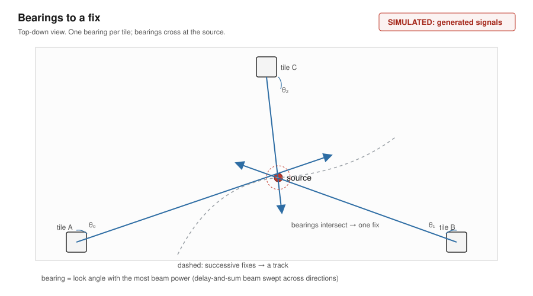
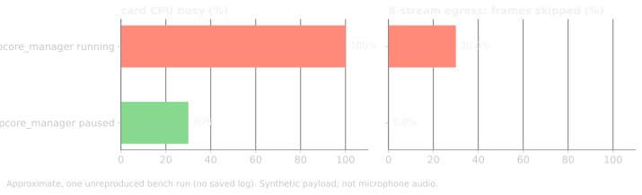
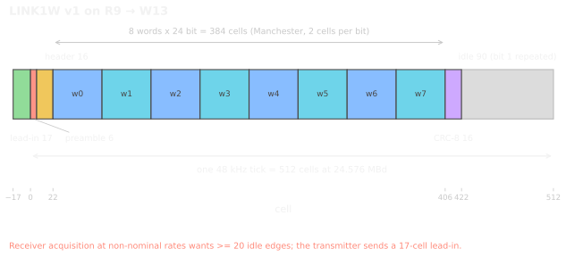

The hub already gets live audio from both tiles over Dante (Part 9). This part covers two things built next to that: a bearing estimator, and a single wire to pull audio straight off the Cyclone.


Bearings
======

The bearing map is a DOA estimator fed generated signals, so I can check it against inputs where I already know the angle:

```
generated signal --> DOA estimator --> hub display --> bearings on a map
```

{: .only-light}
{: .only-dark}

I also pointed a host-side "virtual edge" at the live raw-mic streams. With nothing in the room to track it produced noise-level tracks with a median length of about two seconds. The next run needs a speaker at a measured position.

bma_egressd
======

On the stock image the Zynq's PL packetizes audio somewhere the processor can't read, so I wrote my own egress daemon, `bma_egressd`, with pluggable sources:

```
bma_egressd sources:
  synthetic   -> framing/transport tests
  zynq-pl     -> PL ring reader; the ring now fills from the Cyclone link (below)
  omap-emif   -> not written
```

The synthetic source has run on a card. On November 11 I started `bma_egressd` from RAM on board A's card, under the vendor kernel, broadcasting eight synthetic streams to a receiver on my PC. The receiver saw the array announce itself with eight streams and logged 0.00% loss. That covers the framing and the transport on real hardware. It says nothing about microphone audio. The egress code also has an adaptive mode, up to 64 output streams with a default of 32, that re-steers beams toward a tracker's targets between reads. It is in the source on master. I haven't tested it, and it has not run on a board with microphone audio.

It also showed where the card's CPU goes. With the vendor stack up, the CPU sits at 100%. `ipcore_manager` takes about three quarters of it, and the two UARTs each take about 12,200 interrupts a second: the vendor control link receives a constant stream of `0x00` bytes and logs each one as a lost sync, and that log had filled tmpfs at 119 MB. Under that load the daemon skipped 64,050 of 214,050 frames to stay on time. With `ipcore_manager` paused, the CPU was 69% idle and all eight streams ran with no skipped frames and no send errors. I resumed it afterwards.

{: .only-light}
{: .only-dark}

The host side already has a real-audio checker and a listen mode, both tuned on vendor-path mic audio, so whatever comes out of the custom source gets judged the same way.

The one wire out
======

The only Cyclone-to-Zynq net anyone has measured is the Cyclone's R9 pin landing on the Zynq's W13, so the link is one wire. LINK1W v1 is Manchester at one cell per 24.576 MHz clock, one frame per 48 kHz tick, eight 24-bit words:

{: .only-light}
{: .only-dark}

The preamble is three cells high and three low. No Manchester data can hold a level for three cells, so the receiver can't mistake data for a frame start. The header carries version 1 and the word count, and the CRC-8 (poly 0x07) covers header and words. The receiver takes its cell period from the idle run, which is why every frame needs a lead-in.

Here is the transmitter RTL in Icarus, fed the `ramp8` fixture (words 1, -1, 0x7FFFFF, -0x800000, 0x123456, 0, 2, -2):

{: .only-light}
{: .only-dark}

All 483 cells match the reference model's checked-in vector. The Zynq receiver and image top pass RTL and open-flow checks. The Cyclone transmitter and the SHARC return block pass 12 Icarus simulations on synthetic fixtures. Since then the link has run on boards. The Zynq receiver writes records into a DDR ring. One run on board B captured 8,509,310 records with no gaps, no duplicates and no CRC violations. A small program on the card sends the ring out as UDP, and a 4.4 million record capture arrived with no sequence gaps. Board C's Cyclone runs my own image and its ring runs too. A host bridge feeds the ring into the hub's eight-slot path, and the dashboard shows a waveform.

The frame counter advances at 48,010.5 Hz against the host clock, 220 ppm above 48 kHz, steady to 0.1 ppm over 150 seconds. The two cards differ by 0.3 Hz. The Cyclone's 98.3 MHz clock is 2,048 cycles per frame, not the 24.576 MHz I assumed, and that sets the rate. An earlier 48.7k figure had no measurement behind it, and I removed it.

What the ring carries is not yet shown to be microphone audio. The eight lanes correlate at 0.92 to 0.98 and a tone near 103 Hz dominates. Which microphone is which lane is not mapped. A lane-map search against the measured 121-microphone layout was inconclusive and leans toward a fixed skew per lane. Records are eight lanes, not 32 or 64 streams, and Dante is not in this path.

A script flashes the Cyclone, arms the link, starts the sender and registers a watchdog. The ring-enable step is lost on a power cycle, and the script's cold-start run is still to do.

Replaying one capture through the hub's estimator, 91.7% of windows failed the coherence gate and 5.6% produced a bearing. Those bearings are not evidence of direction.

Scorecard
======

{: .only-light}
{: .only-dark}

The corrected levels hook is merged and host-tested, not loaded on a board; mutating out its scale conversion fails 25 of the host tests. A static review flagged that delayed beam history might survive an epoch change in the egress path. That gets a fix or a test before the combined path goes on a board.

What's left
======

{: .only-light}
{: .only-dark}

Part 9 is the path that runs today: the hub and dashboard on the stock Dante stream.
