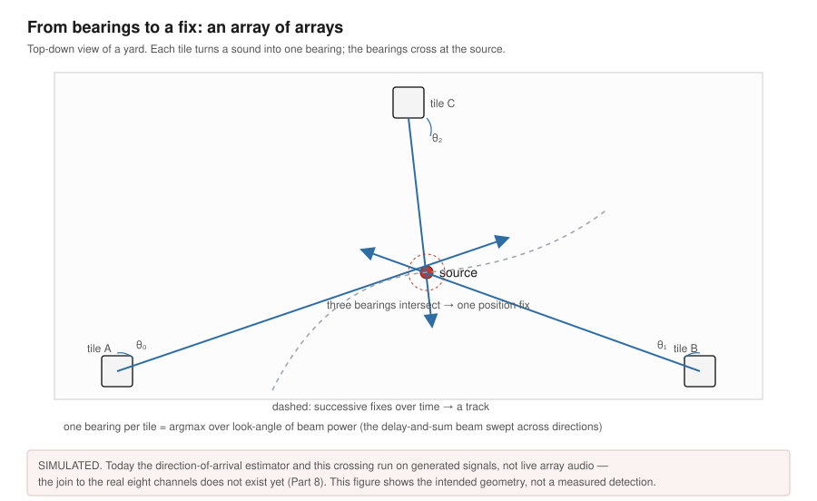

The hub already gets live audio from both tiles over Dante (Part 9). This part covers two things built next to that: a bearing estimator, and a single-wire link to pull audio straight off the Cyclone.


Bearings
======

The bearing map is a DOA estimator fed generated signals, which lets me check the estimator against inputs where I already know the angle.

```
generated signal --> DOA estimator --> hub display --> bearings on a map
```

I also pointed a host-side "virtual edge" at the live raw-mic streams. It produced tracks with a median length of about two seconds, at noise level, with nothing in the room to track. The next run needs a speaker at a measured position.

The geometry it's all for:



bma_egressd
======

On the stock image the Zynq's PL packetizes audio somewhere the processor can't read, so I wrote my own egress daemon, `bma_egressd`, with pluggable sources:

```
bma_egressd sources:
  synthetic   -> framing/transport tests
  zynq-pl     -> PL ring reader; waiting on a PL ring writer + Cyclone wiring
  omap-emif   -> not written
```

The host side already has a real-audio checker and a listen mode, both tuned on vendor-path mic audio, so whatever comes out of the custom source gets judged the same way.

The one wire out
======

The plan is one serialized wire from the Cyclone's R9 pin to the Zynq's W13 pin. A LINK1W v1 frame carries eight 24-bit words:

```
LINK1W v1 FRAME
  6 cells   frame lead
  400 cells body (8 x 24-bit words)
  16 cells  checksum/trailer
  90 cells  inter-frame gap
  ------------------------------------
  512 cells per frame; a 17-cell idle lead-in starts transmission
```

The Zynq receiver and image top pass RTL and open-flow checks. The Cyclone transmitter and SHARC return block pass 12 Icarus simulations on synthetic fixtures. Neither side has been built into a board image.

One known mismatch: the receiver's documented acquisition rule at non-nominal rates wants at least 20 idle edges, and the transmitter sends a 17-cell lead-in. The source of the 24.576 MHz clock and the physical return mapping are also open. Those are the first things to look at with a scope once both images are loaded.

Scorecard
======

```
RUNS ON REAL SILICON (read-only or reversible):
  [+] serial console + our own kernel on the OMAP               (Part 2)
  [+] shell on the Brooklyn-3 Zynq over the internal link        (Part 3)
  [+] FPGA register reads via /dev/c1fpga; version 0x0117        (Part 4)
  [+] level meters move to real sound                            (Part 4)
  [+] our loader loads + identifies the DSPs (52s, 41/41)        (Part 5)
  [+] our one-word ISR hook executes, reversibly                 (Part 5)
  [+] one frame of real mic audio copied off DSP4's ring         (Part 6)
  [+] indexed-copy probe v2 matches absolute copy: 0/48 wrong    (Part 6)

MECHANISM ONLY:
  [~] in-memory bit-exact beam on one DSP4 snapshot              (Part 6)

FAILED:
  [!] indexed-copy probe v1: 42 of 48 words differed             (Part 6)

UNRESOLVED:
  [?] eight Dante channels: gated beams vs raw mics              (Part 7)
  [?] 602-603 sample lag                                         (Part 7)

HOST / RTL TESTS:
  [~] levels-hook indexed caller       (merged; 474 pass, 110 skipped; not board-loaded)
  [~] Zynq receive top + ring path     (not loaded)
  [~] Cyclone TX / SHARC return RTL    (12 synthetic RTL tests; not built)
  [~] Zynq-PL egress source            (needs live PL ring)
  [~] virtual-edge live-input tracks   (short, noise-level)

SIMULATION:
  [-] DOA bearings from generated sources                        (Part 8)
```

For the levels hook, mutating out the scale conversion fails 25 of the host tests. A static review also flagged that delayed beam history might survive an epoch change in the egress path. That gets a fix or a test before the combined path goes on a board.

What's left
======

1. Load the fixed levels hook on a board, and check the multi-frame delay ring, which probe v2 didn't cover.
2. Build R9 TX against W13 RX, settle the lead-in and clock, load both images, check alignment, CRC, and payload on the wire.
3. Real samples through the PL ring reader and egress path, run through the audio checker and listen mode.
4. A controlled capture to pin down the eight Dante channels (Part 7).
5. A bearing on a known source, then two arrays with measured poses and verified slot-to-mic geometry.
6. The 24 silent elements (mics 97-120). That's a fabric rewrite, and the Cyclone bitstream self-loads from its own flash with no way to round-trip it yet (Part 4).

Part 9 is the path that runs today: the hub and dashboard on the stock Dante stream.