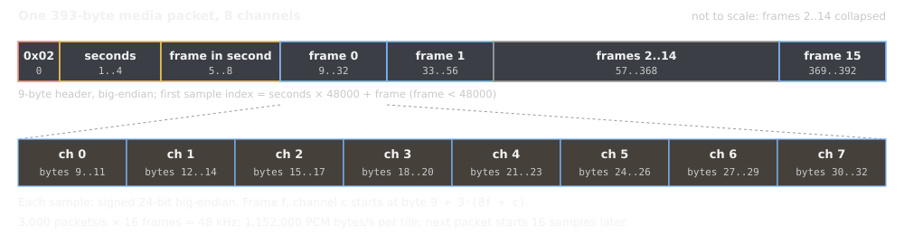
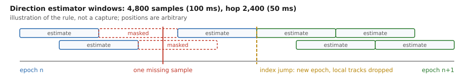
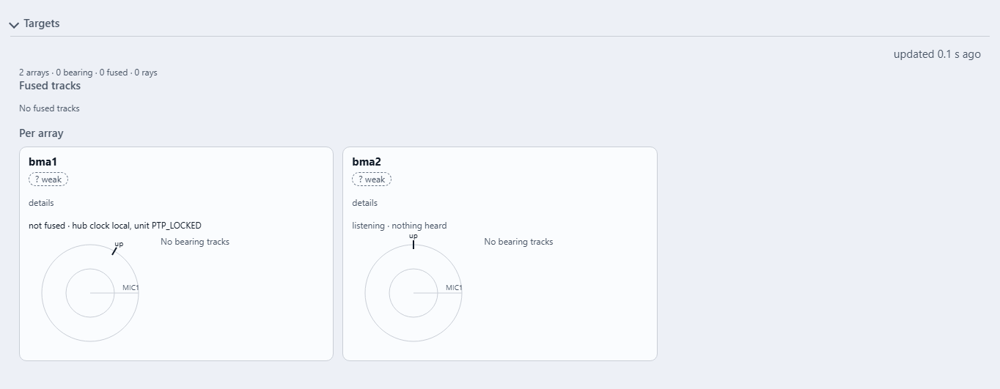
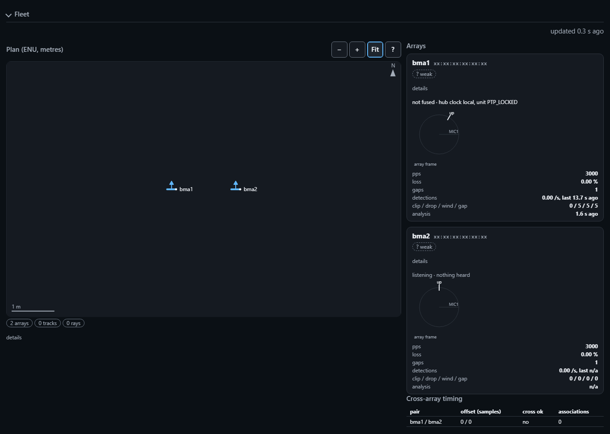
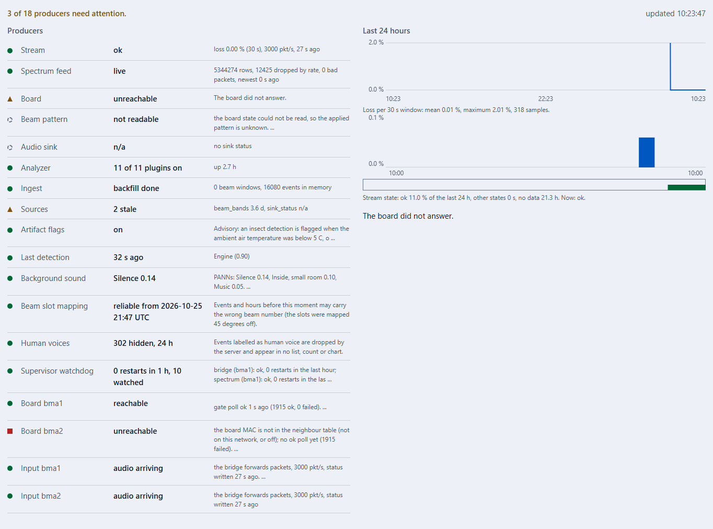
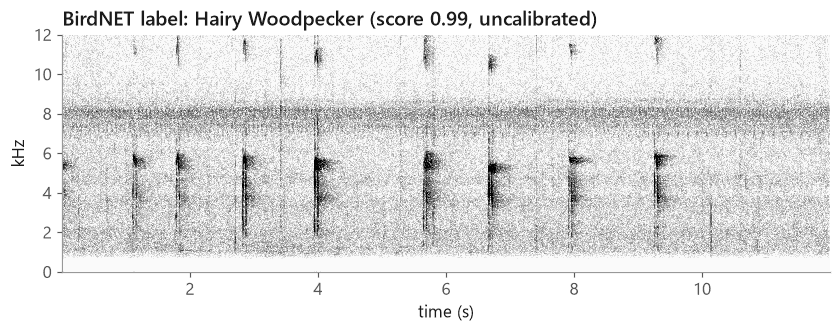
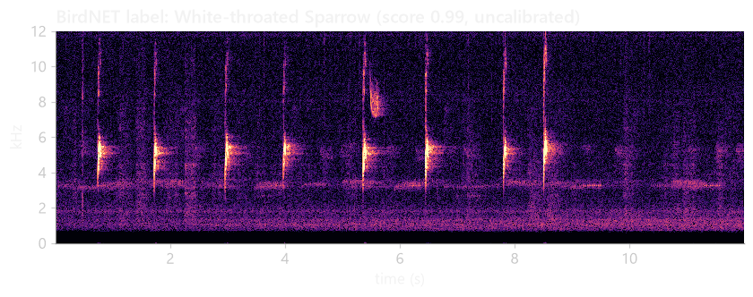

On November 19 both tiles were sending eight channels at 3,000 packets per second with no gaps. Early on November 20 a snapshot of the hub's fleet feed showed **two arrays, two bearing rays, and zero fused tracks**. Each tile could say where a sound came from. Together they could not agree on where it was. This part is about how the audio gets from the tiles to that feed, and what the dashboard makes of it.

Everything here runs on the Brooklyn-3 cards' stock Dante output. It does not use the wire from Part 8.

The pipeline
======

{: .only-light}
{: .only-dark}

It starts with the packets. A media packet in the flow I captured is a 9-byte header followed by 16 frames of interleaved big-endian 24-bit PCM:

{: .only-light}
{: .only-dark}

To turn a sample into a signed number you sign-extend it, subtracting `2**24` when bit 23 is set. Each packet's first index should equal the previous one plus 16, and rollover and restarts get handled separately.

A bridge per tile repacks the channels I select into 256-sample blocks, about 5.33 ms each, on the card's sample clock. When a packet goes missing, the bridge flushes what it has as a short block and marks the next block `gap_before`, so everything downstream knows the stream was interrupted:

{: .only-light}
{: .only-dark}

A supervisor runs one bridge per tile and restarts any that die. It reports packet arrival, nonzero audio and calibrated level as three separate things, because a stream can arrive perfectly and still be silent. On November 19 it read zero loss, with the input-gain check still marked unverified.

On the WSL side the audio splits. A mono branch feeds BirdNET, and an analysis branch does levels, spectra and multichannel classification, gating on activity and logging each detection along with where it came from.

Direction is a third branch. With direction estimation on and a mic map configured, each tile's worker sends angle estimates to the fleet hub, and the hub decides whether reports from different tiles fuse into a position.

{: .only-light}
{: .only-dark}

Every record carries a sample index, an epoch, the registry's clock domain and quality flags. The stock stream has no PTP timestamp, so `t_ns` and `epoch_ns` are null, and a host wall time rides along only for class hints.

That last detail is why nothing fused. The fleet feed says so itself:

{: .only-light}
{: .only-dark}

The hub has a restart guard. If a unit's sample index, after a restart, lands more than 60 seconds off the shared timeline, the guard marks the unit clock-local and refuses to fuse it. Both units show `clock_local`, and the hub's log counts two clock reboots. That guard is my first suspect.

The dashboard
======

To see all this I wrote a Python web service that tails the analysis logs and the fleet feed, copes with log rotation, and keeps hourly summaries so a restart does not blank the charts. These screenshots are from the live hub on 2026-11-20, with MAC addresses masked.

{: .only-light}
{: .only-dark}

The live view shows the last 60 seconds as a waterfall, with one small waterfall per beam underneath. The 100% on the top detection is not a confidence. That score is routinely saturated on screen, I have not traced why, and it is only good for ranking detections.

<video class="bma-av" controls muted loop playsinline preload="none" poster="/images/bma/p09-waterfall-poster.png">
  <source src="/files/bma/p09-waterfall.webm" type="video/webm">
  <source src="/files/bma/p09-waterfall.mp4" type="video/mp4">
</video>

Here are fifteen seconds of that waterfall for array 1, the mean of its eight Dante channels, on the evening of November 20. The dots near 4 kHz and the vertical streaks below 8 kHz are birds. The band near 16 kHz is there all the time.

{: .only-light}
{: .only-dark}

The detections list was mostly a Red-bellied Woodpecker that morning. The scores are BirdNET's own and are uncalibrated.

Positions come only from the hub. The dashboard used to read `/api/v2/targets`, but nothing produces that any more, so the targets panel reads the fleet feed. It shows loading, unavailable, live, stale and "live, no tracks" as five distinct states, because "nothing is tracked" and "I have lost the feed" should never look the same. The spectrum goes stale after 3 seconds and the fleet feed after 5.

{: .only-light}
{: .only-dark}

{: .only-light}
{: .only-dark}

The fleet panel draws the registered tile poses, bearing rays with their angular uncertainty, and any positions the hub reports. The poses started life as my own estimates, whatever the registry's `surveyed` label says. Relative calibration shipped in the November 15 deployment, but its opt-in was not set in the 03:20 snapshot.

{: .only-light}
{: .only-dark}

The system view lists every producer. Three of the eighteen needed attention, including a board that did not answer its poll, while both bridges kept forwarding 3,000 packets a second.

Listening
======

The dashboard can also play what the array hears. The listening engine takes a target, which is either one array's bearing or the fused target (auto-follow picks it from the hub's fused-target state). It steers a 20 ms delay-and-sum beam at it with fractional delays, then aligns the two arrays by cross-correlation. If they lock, it plays both arrays, and if not, one.

{: .only-light}
{: .only-dark}

What it hears
======

These are detection clips the hub saved from array 1, one Dante channel each, through the stock vendor path. Clip audio was on, and the speech guard (below) cleared every one. I high-passed them at 1 kHz and turned them up a lot, by 33 to 52 dB, so they are audible on a laptop. Nothing here is beamformed. The species names are BirdNET's labels, not mine.

<figure class="bma-av">
  <audio controls preload="none">
    <source src="/files/bma/p09-clip-carolina-wren.opus" type="audio/ogg; codecs=opus">
    <source src="/files/bma/p09-clip-carolina-wren.mp3" type="audio/mpeg">
  </audio>
  
  
  <figcaption>Carolina Wren, November 20, 14:25 UTC, channel 7. Three phrases of the song between 2 and 5 kHz.</figcaption>
</figure>

<figure class="bma-av">
  <audio controls preload="none">
    <source src="/files/bma/p09-clip-hairy-woodpecker.opus" type="audio/ogg; codecs=opus">
    <source src="/files/bma/p09-clip-hairy-woodpecker.mp3" type="audio/mpeg">
  </audio>
  
  
  <figcaption>Hairy Woodpecker, November 20, 15:53 UTC, channel 6. Sharp single calls near 5 to 6 kHz. This one was quiet, so the noise floor is loud.</figcaption>
</figure>

<figure class="bma-av">
  <audio controls preload="none">
    <source src="/files/bma/p09-clip-white-throated-sparrow.opus" type="audio/ogg; codecs=opus">
    <source src="/files/bma/p09-clip-white-throated-sparrow.mp3" type="audio/mpeg">
  </audio>
  
  
  <figcaption>BirdNET called this a White-throated Sparrow at 0.99, November 19, 22:00 UTC, channel 7. The spectrogram shows sharp single calls like the woodpecker's above and none of the sparrow's whistles, so I don't believe the label. Uncalibrated scores do this.</figcaption>
</figure>

Reviewing a detection
======

A score is only a guess, so the dashboard has a review view for going through detections one at a time. This is a 15-second screen recording of one: a Northern Flicker that BirdNET scored 0.82, uncalibrated, on beam 8 on November 21.

<video class="bma-av" controls muted loop playsinline preload="none" poster="/images/bma/p09-review-poster.png">
  <source src="/files/bma/p09-review.webm" type="video/webm">
  <source src="/files/bma/p09-review.mp4" type="video/mp4">
</video>

The clip appears as a spectrogram with a level trace and a flux trace under it. I drag a box around the call to select it and loop just that part. Noise reduction toggles between off and strong, and playback can be slowed. The saved clips are single-channel, so the buttons for the other beams are greyed out and the A/B flip does nothing on them.

Then I give a verdict:

| Verdict | Notes |
|---|---|
| correct | |
| wrong | needs a reason: another species, a non-bird sound, machinery, an insect or amphibian, or nothing visible |
| unsure | |
| artifact | |
| human voice | API and command line only; the page has no button for it |

Each verdict also records its basis: the field, the clip's spectrogram, or the metadata alone. The page does not let me name the right species.

I am collecting these verdicts because the scores cannot be calibrated until enough detections carry one. Until then the score on screen is what BirdNET said, and the label is its opinion.

What the hub keeps, and what it does not
======

This is the part of the design that decides what gets stored.

Clip audio is an option, and even with it on a speech guard has to clear each clip before it is kept:

| Situation | What the hub does |
|---|---|
| default | keeps the spectrogram, the signature and the index record; no audio |
| clip-audio on, guard finds speech or a human-voice label within the clip's span plus 5 s either side | drops the clip |
| clip-audio on, verdict missing or late | drops the clip |
| clip-audio on, guard clears it | keeps it for 24 hours after capture, then deletes it |
| a human-voice verdict, entered through the API or command line | deletes the clip immediately |

The verdict stays in every case, so a label can outlive the audio it describes. And I listen to every clip myself before it goes into a post like this one.

A decoder test you can run without a tile
======

If you want to check your own decoder against these packets, here is a test on synthetic values. It catches the usual byte-order and sign-extension mistakes:

```python
import struct

header = bytes.fromhex("020000007b000001c8")  # marker, second=123, frame=456
frame = bytes.fromhex(
    "800000ffffff0000000000017fffff00002affffd6000011"
)
packet = header + frame * 16
assert len(packet) == 393

def signed24(b):
    value = int.from_bytes(b, "big")
    return value - (1 << 24) if value & (1 << 23) else value

first_frame = [
    signed24(packet[9 + 3*c : 12 + 3*c])
    for c in range(8)
]
sample_index = 123 * 48000 + 456
assert sample_index == 5904456
assert first_frame == [-8388608, -1, 0, 1, 8388607, 42, -42, 17]
```

Back on the bench
======

The next session uses the Dante path as the control. A fixed source goes at a measured spot while I log both bridges' loss and gap counts, each array's angles and sample indices, the hub's clock eligibility and pose state, and any fused position. Then silence, then the source moved.

For the custom path from Part 8, the first test is a real DSP payload captured at the Zynq receiver and followed through the ring into the host. Before that, the 17-cell lead-in gets checked against the receiver's 20-idle-edge rule, and the host gets a regression test that rejects delayed samples from a previous epoch.
