On November 19 both tiles were sending eight channels at 3,000 packets per second with no gaps. A snapshot of the hub's fleet feed early on November 20 showed **two arrays, two bearing rays, and zero fused tracks**.

This runs on the Brooklyn-3 cards' stock Dante output, not the wire from Part 8.

## The pipeline

{: .only-light}
{: .only-dark}

A media packet in the flow I captured is a 9-byte header plus 16 frames of interleaved big-endian 24-bit PCM:

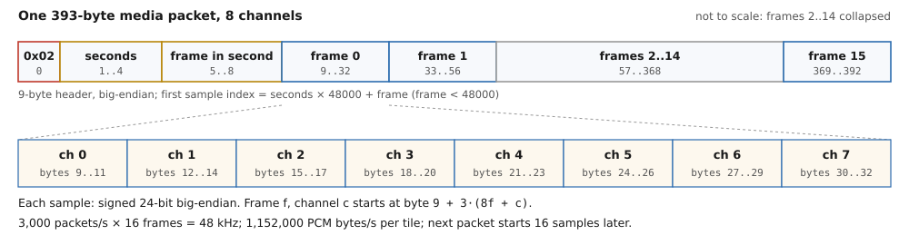{: .only-light}
{: .only-dark}

Sign-extend by subtracting `2**24` when bit 23 is set. Each packet's first index should be the last one plus 16; rollover and restarts get handled separately.

The bridge repacks selected channels into 256-sample blocks (about 5.33 ms) on the card's sample clock. When a packet goes missing it flushes what it has as a short block and marks the next one `gap_before`:

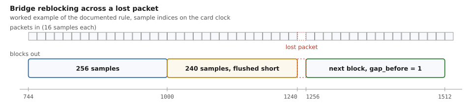{: .only-light}
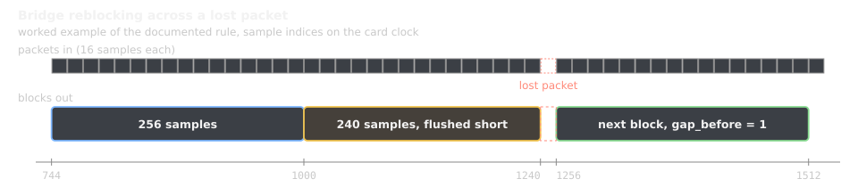{: .only-dark}

A supervisor runs one bridge per tile, restarts any that die, and reports packet arrival, nonzero audio, and calibrated level separately. On November 19 that read zero loss, with the input-gain check still marked **unverified**.

On the WSL side a mono branch feeds BirdNET, and an analysis branch does levels, spectra, and multichannel classification. The classifier gates on activity and logs each detection with its provenance.

Direction is a third branch. With direction estimation on and a mic map configured, each tile's worker sends angle estimates to the fleet hub, and the hub decides whether reports from different tiles fuse into a position.

{: .only-light}
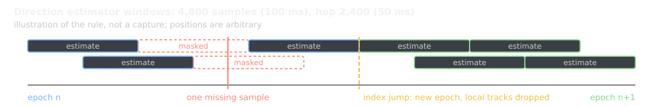{: .only-dark}

Records carry sample index, epoch, registry clock domain, and quality flags. BMAA has no PTP timestamp, so `t_ns` and `epoch_ns` are null; a host wall time rides along for class hints.

Nothing fused, and the fleet feed says why:

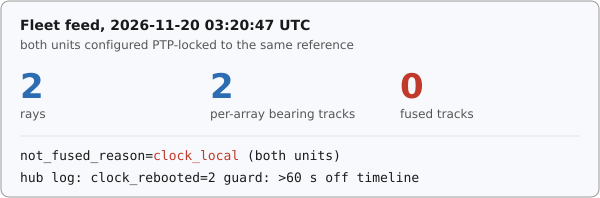{: .only-light}
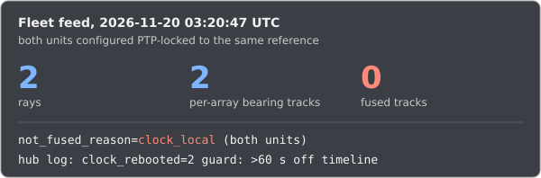{: .only-dark}

The hub has a restart guard that marks a unit clock-local if its post-restart sample index lands more than 60 seconds off the shared timeline. That's my first suspect.

## The dashboard

A Python web service tails the analysis logs and the fleet feed, handles rotation, and keeps hourly summaries so a restart doesn't blank the charts. These are from the live hub on 2026-11-20; MAC addresses are masked.

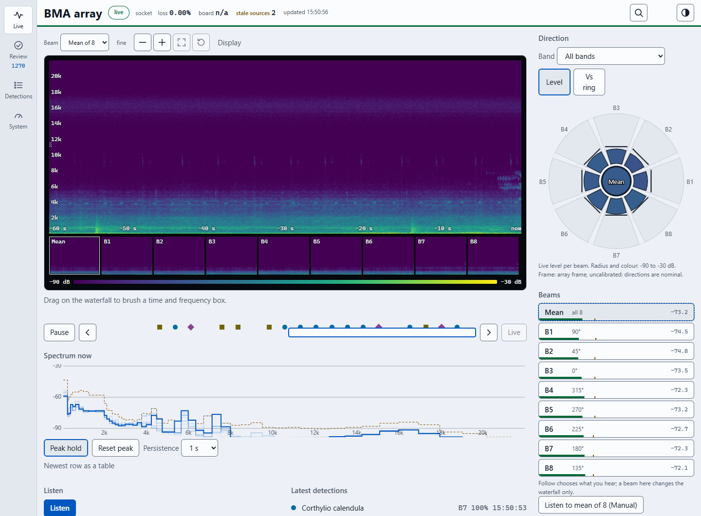{: .only-light}
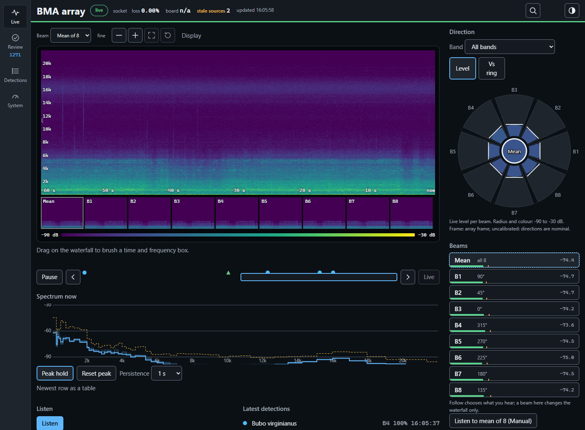{: .only-dark}

The live view, with the last 60 seconds in the waterfall and one small waterfall per beam under it. Ignore the 100% on the detection: the dashboard runs the classifier's raw score through a sigmoid, and the top score is always big enough to round to 100. It ranks detections; it isn't a confidence.

<video class="bma-av" controls muted loop playsinline preload="none" poster="/images/bma/p09-waterfall-poster.png">
  <source src="/files/bma/p09-waterfall.webm" type="video/webm">
  <source src="/files/bma/p09-waterfall.mp4" type="video/mp4">
</video>

Fifteen seconds of the waterfall, array 1, the mean of its eight Dante channels, on the evening of November 20. The dots near 4 kHz and the vertical streaks below 8 kHz are birds; the band near 16 kHz is there all the time.

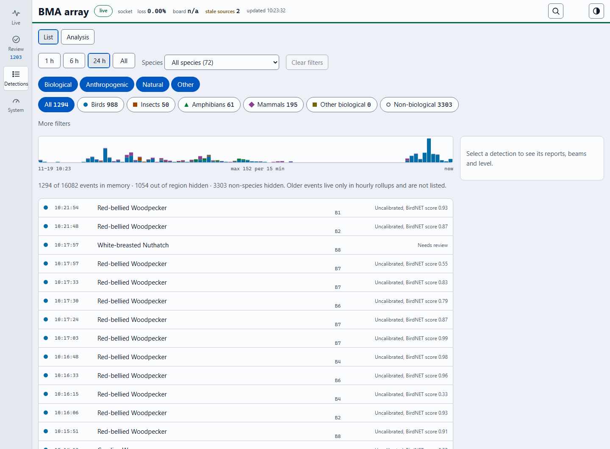{: .only-light}
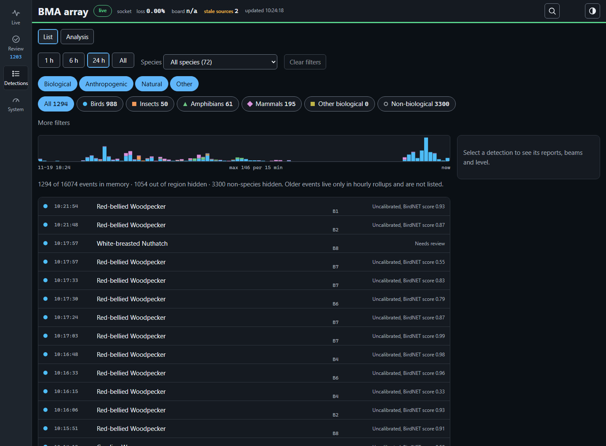{: .only-dark}

Detections, mostly a Red-bellied Woodpecker that morning. Scores are uncalibrated BirdNET scores.

Positions come only from the hub. Targets used to read `/api/v2/targets`; nothing produces that anymore and the panel reads the fleet feed instead. It shows loading, unavailable, live, stale, and "live, no tracks" as distinct states. Spectrum goes stale after 3 seconds, the fleet feed after 5.

{: .only-light}
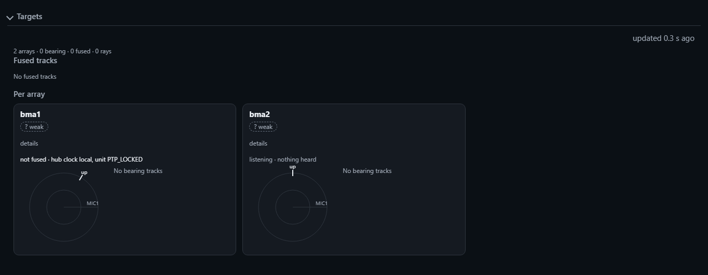{: .only-dark}

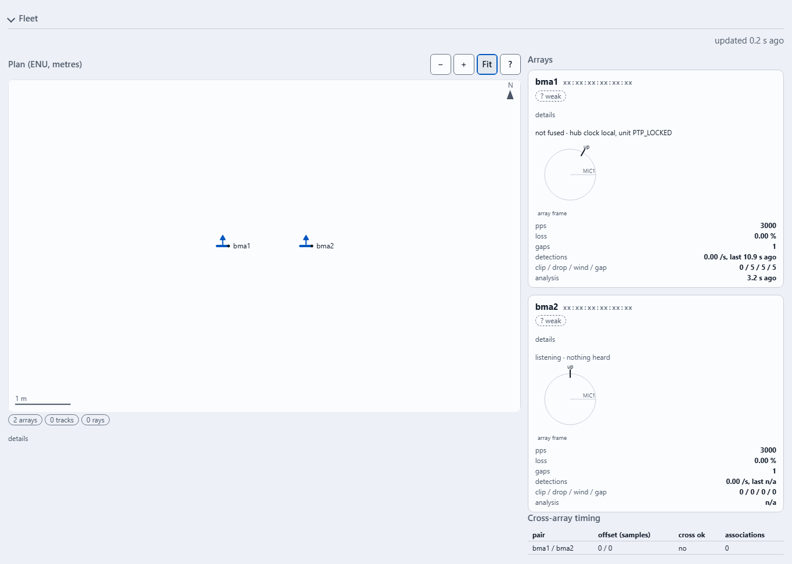{: .only-light}
{: .only-dark}

The fleet panel draws registered tile poses, bearing rays with angular uncertainty, and hub-reported positions. The tile poses started as my estimates, whatever the registry's `surveyed` label says. Relative calibration shipped in the November 15 deployment but its opt-in wasn't set in the 03:20 snapshot.

{: .only-light}
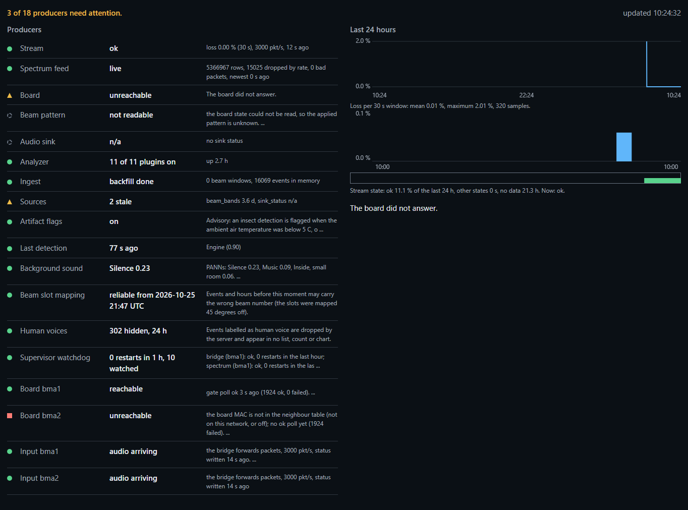{: .only-dark}

The system view lists every producer. Three of eighteen needed attention, including a board that didn't answer its poll, while both bridges kept forwarding 3,000 packets a second.

## Listening

The listening engine steers a host-side delay-and-sum beam at one array's bearing, or at a fused target when there is one. It builds 20 ms chunks with fractional delays and aligns arrays by cross-correlation; if that doesn't lock, it plays one array. There's also an auto-follow mode that picks its target from the hub's fused-target state.

## What it hears

These are detection clips the hub saved from array 1, one Dante channel each, through the stock vendor path. I high-passed them at 1 kHz and turned them up a lot (33 to 52 dB) so they're audible on a laptop; nothing here is beamformed. The species names are BirdNET's labels, not mine.

<figure class="bma-av">
  <audio controls preload="none">
    <source src="/files/bma/p09-clip-carolina-wren.opus" type="audio/ogg; codecs=opus">
    <source src="/files/bma/p09-clip-carolina-wren.mp3" type="audio/mpeg">
  </audio>
  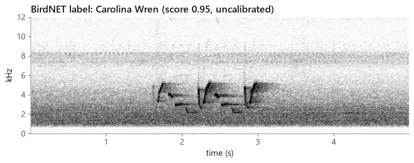
  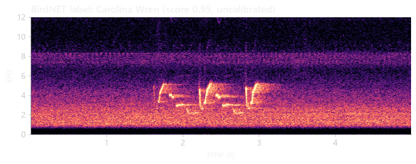
  <figcaption>Carolina Wren, November 20, 14:25 UTC, channel 7. Three phrases of the song between 2 and 5 kHz.</figcaption>
</figure>

<figure class="bma-av">
  <audio controls preload="none">
    <source src="/files/bma/p09-clip-hairy-woodpecker.opus" type="audio/ogg; codecs=opus">
    <source src="/files/bma/p09-clip-hairy-woodpecker.mp3" type="audio/mpeg">
  </audio>
  
  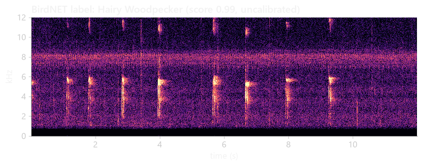
  <figcaption>Hairy Woodpecker, November 20, 15:53 UTC, channel 6. Sharp single calls near 5 to 6 kHz. This one was quiet, so the noise floor is loud.</figcaption>
</figure>

<figure class="bma-av">
  <audio controls preload="none">
    <source src="/files/bma/p09-clip-white-throated-sparrow.opus" type="audio/ogg; codecs=opus">
    <source src="/files/bma/p09-clip-white-throated-sparrow.mp3" type="audio/mpeg">
  </audio>
  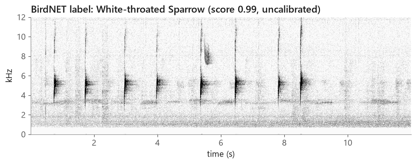
  
  <figcaption>BirdNET called this a White-throated Sparrow at 0.99, November 19, 22:00 UTC, channel 7. The spectrogram shows sharp single calls like the woodpecker's above and none of the sparrow's whistles, so I don't believe the label. Uncalibrated scores do this.</figcaption>
</figure>

## A decoder test you can run without a tile

Synthetic values, for catching byte-order and sign-extension mistakes:

```python
import struct

header = bytes.fromhex("020000007b000001c8")  # marker, second=123, frame=456
frame = bytes.fromhex(
    "800000ffffff0000000000017fffff00002affffd6000011"
)
packet = header + frame * 16
assert len(packet) == 393

def signed24(b):
    value = int.from_bytes(b, "big")
    return value - (1 << 24) if value & (1 << 23) else value

first_frame = [
    signed24(packet[9 + 3*c : 12 + 3*c])
    for c in range(8)
]
sample_index = 123 * 48000 + 456
assert sample_index == 5904456
assert first_frame == [-8388608, -1, 0, 1, 8388607, 42, -42, 17]
```

## Back on the bench

Next session uses the Dante path as the control: a fixed source at a measured spot, logging both bridges' loss and gap counts, per-array angles and sample indices, hub clock eligibility and pose state, and any fused position. Then silence, then the source moved.

For the custom path, the first test is a real DSP payload captured at the Zynq receiver and followed through the ring into the host. Before that, the 17-cell lead-in gets checked against the receiver's 20-idle-edge rule, and the host gets a regression test that rejects delayed samples from a previous epoch.