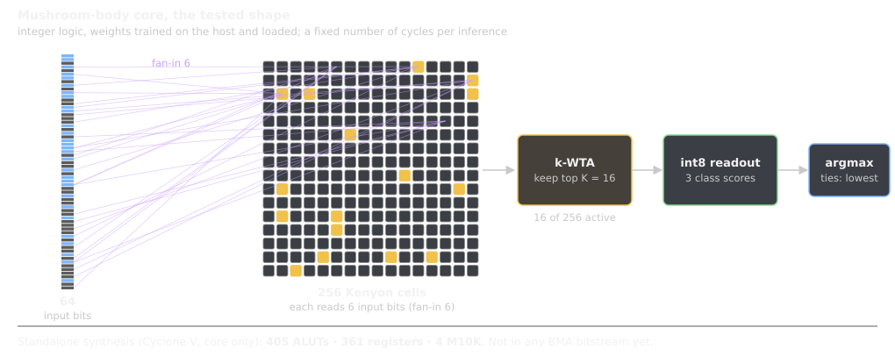
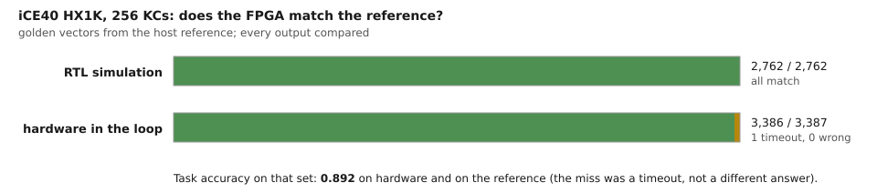
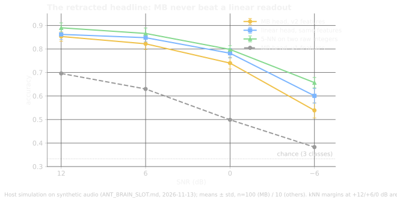
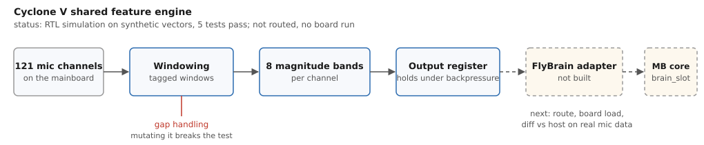

FlyBrain is my side project for learning small-model design from insect brains. It has a training pipeline in the cloud, a Rust simulator, a Python reference, and integer RTL for FPGAs. The BMA360 gives it a real job: put small classifiers next to the microphones and send the hub fewer, better-labelled events.

## Where it fits

Each array has three places a model could run, and each gets a different job:

![Block diagram of one array: SHARC DSPs do beamforming; the Cyclone V runs the ants, one small classifier per beam or channel; the Zynq runs a second FlyBrain stage over ant results, beams and metadata; the hub runs Perch and BirdNET and matches across arrays. Today only the stock audio path over Dante to the hub runs. The results link into the Cyclone has no receive RTL, and the sideband to the Zynq is a draft with nothing on the wire. The OMAP-to-Zynq metadata path and the hub's command path are proposals.](/images/bma/p10-system-split-light.svg){: .only-light}
![Block diagram of one array: SHARC DSPs do beamforming; the Cyclone V runs the ants, one small classifier per beam or channel; the Zynq runs a second FlyBrain stage over ant results, beams and metadata; the hub runs Perch and BirdNET and matches across arrays. Today only the stock audio path over Dante to the hub runs. The results link into the Cyclone has no receive RTL, and the sideband to the Zynq is a draft with nothing on the wire. The OMAP-to-Zynq metadata path and the hub's command path are proposals.](/images/bma/p10-system-split-dark.svg){: .only-dark}

- **Ants on the Cyclone.** FlyBrain runs on both FPGAs, with different jobs. The mainboard Cyclone V is where the mic and beam signals are, so that is where the ants go (design and RTL simulation only). An ant is a tiny integer classifier attached to one beam or channel. It answers one narrow question per window, like "noise, bird-like, or drone-like?".
- **A second stage on the Zynq.** The Zynq on the Brooklyn-3 card runs FlyBrain over what the ants and beams already produced, plus metadata. It lines results up over short windows, fuses across ants, beams and time, picks the beams worth sending, drops anything stale or full of gaps, and tags what goes out. It also handles the broader telemetry and network work. It must not rerun the ants on raw TDM words; an earlier branch did exactly that, and I'm rebuilding it.
- **The fleet brain on the hub.** Perch, BirdNET, cross-array matching and review stay on the hub's GPU, where they already run on the Dante audio (Part 9).

The OMAP is the metadata and control plane, never an audio path. The design has it collecting the FPGA and DSP meters plus batched register and health reads from the Cyclone and SHARCs. The Zynq should keep that sideband, with its provenance and its stale, gap and loss markers, instead of losing it once audio moves on. No transport from the OMAP to the Zynq has been verified; that interface is open.

The hub link runs both ways. Commands, config, acks, time and health go from the hub to the array. Evidence and telemetry come back. Messages between sister arrays are a separate, versioned path. Data and control stay on separate planes, and whether arrays talk directly or through the hub is undecided.

Every event the Zynq stage sends has to say exactly where it came from: array and boot epoch, the exact sample range, beam or channel, gaps and padding, which model and preprocessing produced the score, and what the score means. If two events can't be aligned on samples, they don't get joined. A rounded wall-clock time isn't a join key. Raw audio and the scores derived from it stay separate, so I can always go back to the audio.

## What an ant computes

The ant I've built is AntFeatureEncoder v2 plus a small head. It turns 1,024 samples of one beam (21.3 ms at 48 kHz) into a 64-bit code, then into a class and three scores:

{: .only-light}
{: .only-dark}

Each step is cheap in fabric:

- **Split.** A one-pole low-pass at about 477 Hz and the residual. It's crude, not a filter bank, and the noise class pays for that.
- **Window sums.** The sum of absolute values of each half, and how often the residual changes sign.
- **Log.** The position of the leading one times four, plus the next two bits. That's about 1.5 dB per step, with no multiplier or divider.
- **Floors.** A noise floor per band that drops to a new minimum immediately and climbs one step every 64 windows (1.37 s).
- **Fields.** The low/high ratio, each band's height above its floor, and the crossing rate. Each field is coded as a "bump" of two or three adjacent hot bits, so nearby values share bits and no bit is stuck on or off. That matters for the mushroom-body head below, whose cells read six random bits each.

The ratio and crossing fields don't change when the whole signal gets louder. The above-floor fields are what carry level.

## One ant, running

This is the reference encoder's real output for a synthetic stream: a quiet coloured-noise background, a 3 kHz tone at two levels 12 dB apart, a 2–7 kHz chirp, and a stack of 150 Hz harmonics standing in for a drone:

{: .only-light}
{: .only-dark}

What the plot shows:
- **Level.** The two tones are 12 dB apart. Their crossings match exactly (128 per window) and the ratio moves one step, from 10 to 11. Only the low-band height changes much, from 9 to 16 steps above its floor.
- **Chirp.** You can see the sweep as a ramp in both the ratio and the crossing count.
- **Drone.** It's the one sound with more energy below 477 Hz than above it, so its ratio goes negative.

When the sound stops, every field drops back to background within a window or two.

The RTL matches this reference bit for bit in simulation, on every output and on the cycle each code appears. The test benches cover random full-scale input, DC at the most negative value, alternating full scale, tiny signals and a sine, with random gaps between samples. Four deliberate breakages, in the encoder, the slot and the evaluation, each turned the tests red. In Yosys, the encoder alone comes to 1,312 cells, and with the MB core attached it's 2,033 cells and 4 M10K blocks. None of that has been placed, routed, or loaded on a board.

## The head

The first head I tried copies the insect mushroom body (MB). Each code fans out to a few hundred Kenyon cells, each wired to six random input bits. Only the 16 strongest cells stay on, and an int8 readout scores the classes from those:

{: .only-light}
{: .only-dark}

One inference takes 1,803 clocks, whatever the input. At the array's real sample rate a window is 524,288 clocks, so one MB core has time for about 290 inferences per window, enough for many ants to share it.

Weights come from the host: training data, a Python trainer and reference, exported weights with a SHA-256 sidecar, and the same golden vectors fed to both the Python tests and the RTL testbench:

{: .only-light}
{: .only-dark}

All the learning happens on the host for now, because that's what the FPGA testing needed. Nothing rules out learning on the chip, and learning rules borrowed from biology are part of what FlyBrain is for. None of that runs on the BMA hardware.

## Two FPGA prototypes

Before the BMA, the MB core ran on two other boards:

{: .only-light}
{: .only-dark}

I still owe the iCE40 an explanation for that one timeout. A newer core on a VU47P ran 722 inferences/s, and training on it was at most about 1.2x faster, so for inference the FPGA is fast. That benchmark measures inference only; it doesn't settle the FPGA's whole role, and learning on the chip is still a research question.

## A retracted result

I had an accuracy headline for the MB head and retracted it. Here are the numbers underneath, from host simulation on synthetic audio with three classes (noise, bird-like tones and chirps, drone-like harmonics):

{: .only-light}
{: .only-dark}

The v2 code is a real improvement:
- **Against v1.** It beat the old thermometer code in all 100 paired runs at every SNR, by 0.16 to 0.24.
- **Against level.** With the test audio shifted 12 dB either way, its accuracy moved by at most 0.002.

The MB head is the weak part:
- **Against a linear readout.** A plain linear head on the same 64 bits did better at every SNR.
- **Against nearest neighbours.** A 5-nearest-neighbour vote on just two raw integers, the band ratio and the crossing count, did best of all.

So the features carry the information, and the head should be whatever is cheapest. With at most 12 hot bits, a linear head is at most 12 int8 additions per class, with no multiplier. That's what gets the FPGA area unless the MB head beats it on real recordings.

## Feeding 121 mics

The ant above reads one beam. A proposed shared engine on the Cyclone would read all 121 mic channels and computes eight magnitude bands for each, for the ants to share:

{: .only-light}
{: .only-dark}

It passes five RTL tests on synthetic vectors, and breaking the gap handling on purpose fails the comparison.

## What exists

| Piece | State |
|---|---|
| Ant encoder v2 + `brain_slot` | RTL bit-exact with the reference in simulation; synthesised; not in any top-level design |
| MB core | Bit-exact in simulation; ran on an iCE40 and a VU47P; not in any BMA image |
| 121-mic feature engine | Five RTL tests on synthetic vectors; not routed |
| SHARC results into the Cyclone | No receive RTL yet |
| Cyclone→Zynq link | Partial contract (2026-11-15): 10.0, 10.2 stage 1 and 10.3 signed; the 10.4 result sideband is a draft and sends zeros. Only the frame-sync pin is accepted; the clock and remaining pin mapping aren't proven |
| OMAP metadata to Zynq | Design only; no verified transport |
| Zynq second stage (`bk3_brain`) | Simulation only, being rebuilt around that sideband |
| Hub models | Running on Dante audio |

No FlyBrain logic has been loaded onto a BMA board.

## Next

1. Freeze the Cyclone→Zynq contract and the exact bit mapping, and get it reviewed against the source.
2. Replay recorded event streams offline, including resets, gaps, reordering and model changes, and check the Zynq stage joins only what it should.
3. Compare features and heads on real array recordings with clean train/test splits, calibrated scores and per-class numbers, with the linear and nearest-neighbour baselines on the same examples.
4. Synthesis, timing and an independent RTL review.
5. Only after that, a bench load on one array, with its own review and sign-off. Our Cyclone images already go through that gate. The latest one, a link probe with no FlyBrain logic in it, was reviewed on 2026-11-20 and got a NO-GO, so it hasn't been loaded.

The FlyBrain, training, and firmware repos are private for now. A public version needs a sanitized snapshot, pinned tool versions, data provenance, and the golden vectors.
