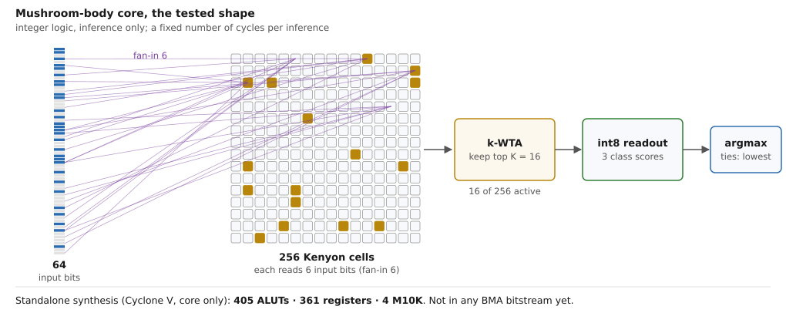
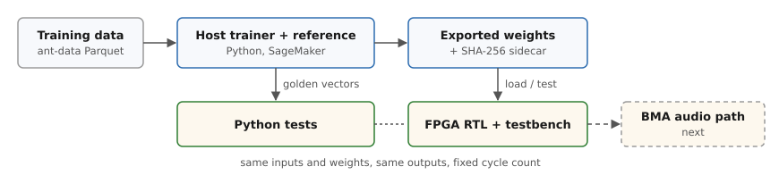
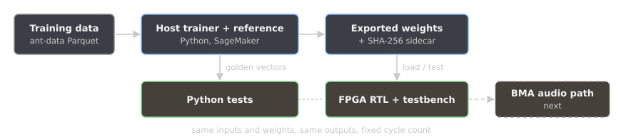
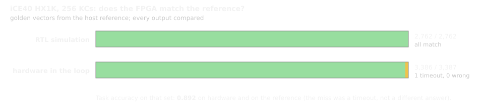
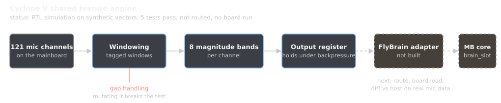
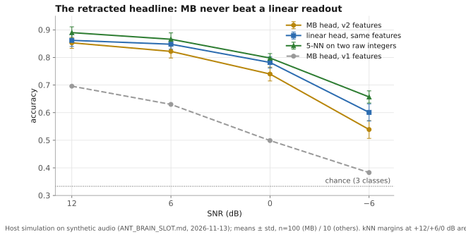

FlyBrain is a side project that runs alongside the array: small classifiers modeled on the insect mushroom body, with a CPU reference on the host and integer RTL for FPGAs. The goal is to hang one off the BMA360's Cyclone and classify what the mics hear.

## The model

An encoder expands a feature vector into a sparse set of Kenyon-cell (KC) activations, and a small readout maps those to class scores. The FPGA core is all integer logic. One tested shape:

{: .only-light}
{: .only-dark}

The host side has the Python reference, tests, and training tools. A SageMaker pipeline trained encoders from ant-data Parquet files and exported model bundles with SHA-256 sidecars. The reference sets the contract for the RTL, and the FPGA core does inference only for now.

{: .only-light}
{: .only-dark}

## Two FPGA prototypes

{: .only-light}
{: .only-dark}

I still owe the iCE40 an explanation for that one timeout. A newer core on a VU47P ran 722 inferences/s, and training sped up by at most ~1.2x, so edge inference looks like the useful job for the FPGA. Neither board is the BMA360.

## On the Cyclone

The BMA-specific RTL targets the mainboard Cyclone V, where ClearOne does its audio processing alongside the OMAP. The Zynq on the Brooklyn-3 card only does Dante.

There are two feature encoders, a thermometer-style v1 and a level-invariant v2. A `brain_slot` wrapper connects an encoder to the mushroom-body core, exposes a result register, and flags a dropped start. Nothing in the tree instantiates `brain_slot` yet, and `mb_core` isn't in that tree, so there's no BMA bitstream with it.

The newest piece is a shared engine that reads all 121 mic channels and computes eight magnitude bands:

{: .only-light}
{: .only-dark}

It passes five RTL tests on synthetic vectors, and mutating the gap handling breaks the expected comparison. Next for it: routing, a board load, and a comparison against a host implementation on real mic data. After that comes an adapter from those bands into a FlyBrain input.

## A retracted result

I had an accuracy headline for the mushroom-body readout. I retracted it. These are the numbers underneath, from host simulation on synthetic audio:

{: .only-light}
{: .only-dark}

On the documented 64-bit features the MB head never beat a plain linear readout, and a 5-NN over two raw integer features beat both. If a linear head matches it on the same features, the linear head gets the FPGA area.

## Next

Model side: freeze a dataset, split, encoding, weights, and hash; record reference outputs including edge cases; run the same vectors through the RTL and diff every output and cycle count, with the linear and 5-NN baselines on the same examples.

Array side: push known mic data through the Cyclone feature block on a board, save the bands and tags, diff against the host version, then train weights on array data and score them.

The FlyBrain, training, and firmware repos are private for now. A public version needs a sanitized snapshot, pinned tool versions, data provenance, and the golden vectors.