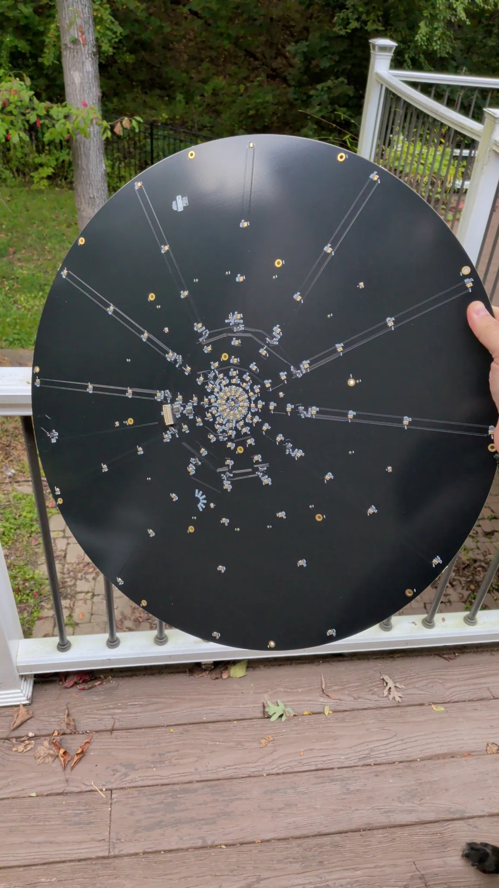
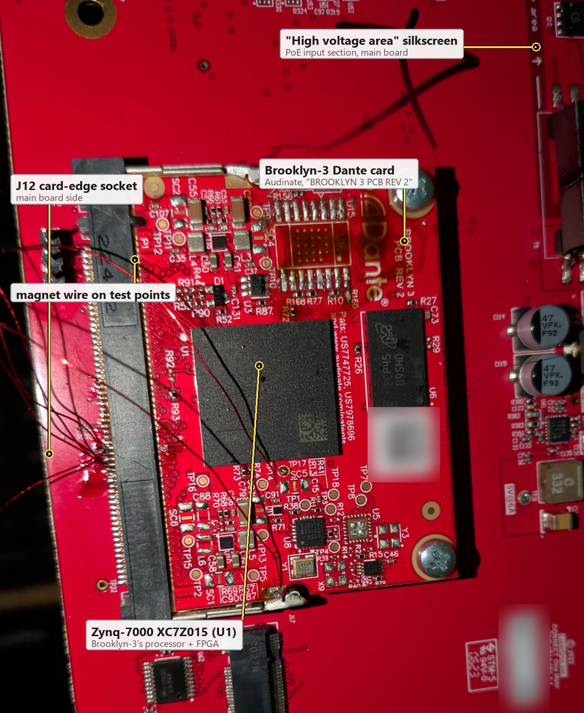
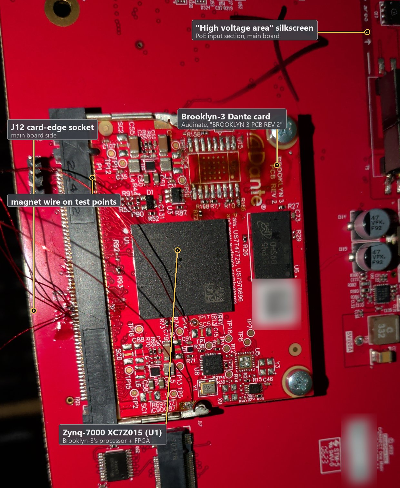
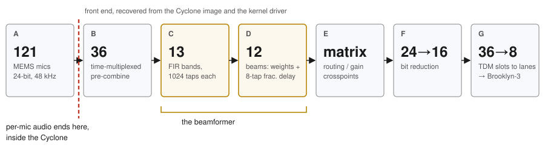
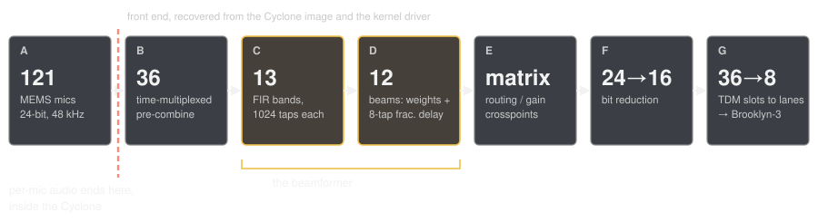
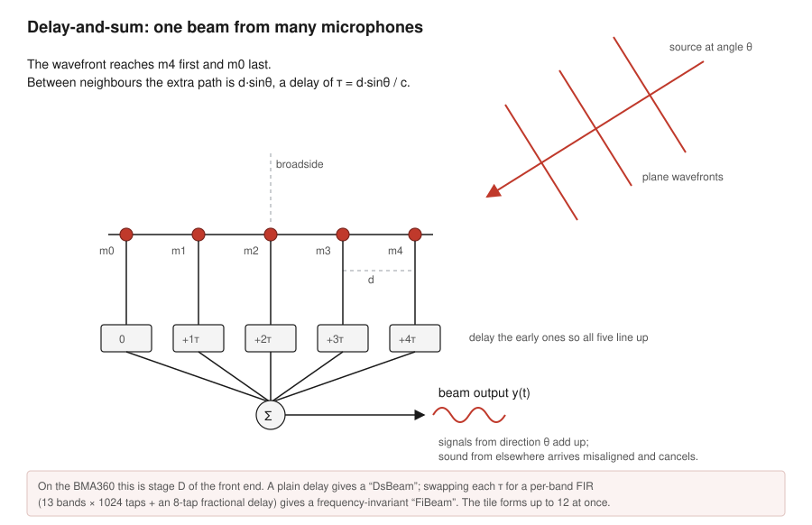
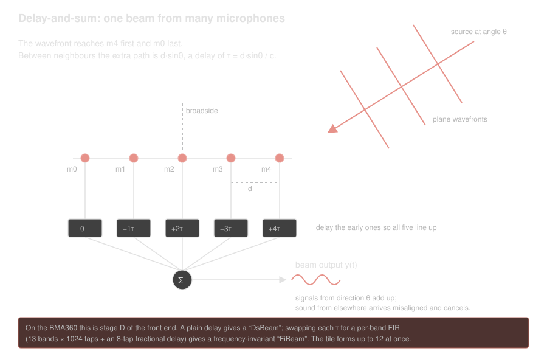

This series is about turning a conference-room ceiling microphone into an acoustic camera. The idea: put several tiles around a yard, have each one turn a sound into a bearing, cross the bearings into a position and string the positions into a track. The target is birds. I call it the Bird Microphone Array, which works out because the product is already called a BMA.

The BMA 360D is a 24-inch square ceiling tile, about 5 kg, that drops into a suspended-ceiling grid in place of a normal tile. ClearOne designed it. In October 2025 Biamp bought ClearOne's IP and brands, and Biamp's support pages say it will not supply ClearOne firmware, documentation or support. Mine came off the surplus market, so whatever I learn about it, I learn from the hardware. The firmware calls the board the BMA360DX, so that's the name I use.

The datasheet is why I bought it. There are 121 microphone elements in the tile. Stock firmware forms up to twelve beams at once, puts each beam on its own Dante channel next to an echo-cancelled mix, and reports beam activity over a plain-text TCP port so a PTZ camera can turn toward whoever is talking. If it can point a camera at a person, it can probably point one at a bird.



The plan was: buy a few, read the beams off Dante, cross the bearings on a PC. I expected the tracking math to be the hard part. Getting a single sample out of the tile was harder.

What is in the tile
======

I took one apart and read the part numbers off the chips. It's two boards: ClearOne's main board, and an Audinate Brooklyn-3 Dante card plugged into it.

{: .only-light}
{: .only-dark}

Here's how the parts connect:

{: .only-light}
{: .only-dark}

There are two FPGAs on the parts list and only one is in the audio path. The Cyclone V on the main board runs the microphone front end, the 121-to-36 fold and the routing matrix. The Zynq on the Brooklyn-3 is a Dante interface. It takes finished audio over a card-edge TDM bus and puts it on the network. All of ClearOne's signal processing happens on the Cyclone and the SHARCs. I spent a while assuming the Zynq was where the interesting stuff happened, and I was wrong.

The OMAP runs Linux, but no audio goes through it. There is no sound card:

```
board$ cat /proc/asound/cards
--- no soundcards ---
```

The OMAP loads code onto the DSPs over SPI and writes FPGA registers over EMIF. The samples go mic, Cyclone, SHARC, Brooklyn-3 and never land in a Linux buffer, so there's nothing to `arecord`. That ruled out the easy version of this project.

Where the microphones go
======

From the Cyclone image and the kernel driver, the front end looks like this:

{: .only-light}
{: .only-dark}

Stages C and D are the beamformer. It's delay-and-sum: line up the arrivals from one direction and add them.

{: .only-light}
{: .only-dark}

To steer your own beams you need the raw elements, because they are the aperture. Stage B folds 121 microphones into 36 channels inside the Cyclone, before anything downstream sees them. Per-element audio only exists inside the FPGA. The product never sends it off the tile.

There's another problem I'll get to in Part 4: the shipped bitstream only carries mics 1-96 and mic 121. Mics 97-120 are silent, so 24 elements of aperture are switched off in firmware.

Where the stages split
======

When a bearing comes out wrong, I need to know which stage caused it: the microphones, the fold, the SHARC channel order, the FPGA route, the Dante mapping or my own code on the PC. Most of this series is about getting a probe between two of those stages on hardware built as a sealed appliance.

Next: [Part 2, a serial console and a kernel I built myself](/posts/2026/11/bma360-part-2/).