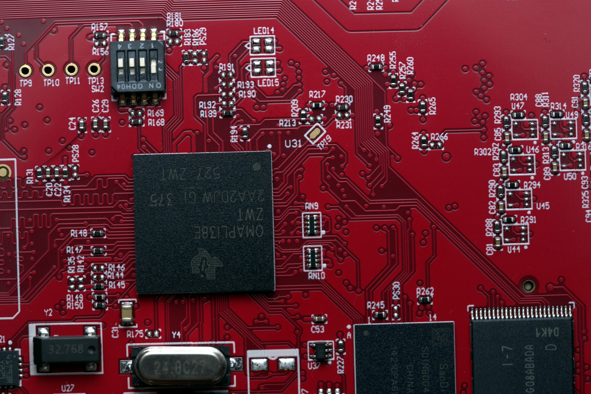
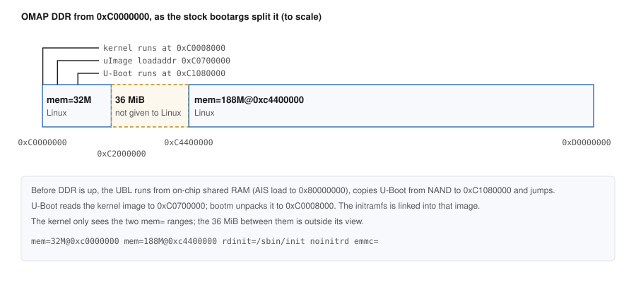
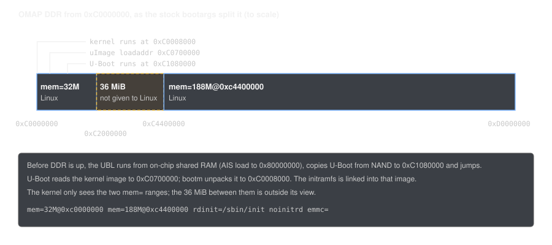
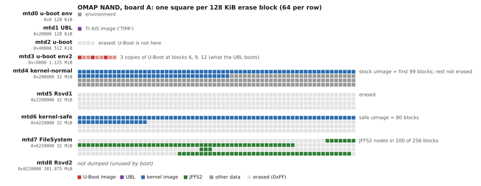
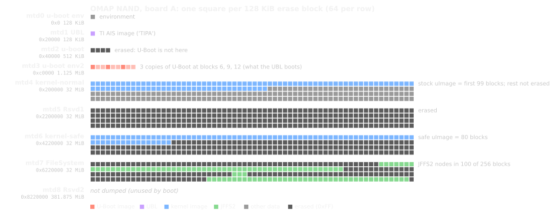
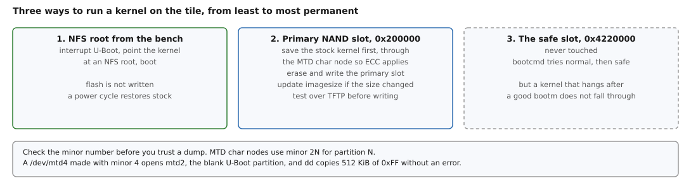
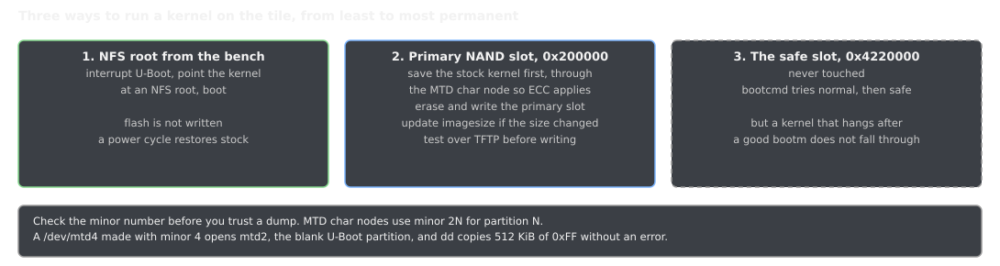

At the end of [Part 1](/posts/2026/11/bma360-part-1/) the audio never entered Linux, so there was nothing to record from userspace. Before I can change that I need a shell on the OMAP that I control, and then a kernel I built. This part covers the serial console, the boot chain, an NFS root that changes nothing on the device, and a kernel written into flash with the factory recovery image left alone.

The header
======

The OMAP module has a 4-pin 0.1" header labelled `J8`, and the vendor's board notes call it `Linux 115200`. I put a 3.3 V USB-UART dongle on `J8` at 115200 8N1 and the board talks on power-up. The other header, `J6` at 57600, is the RS-232 control port, not the Linux console.



The boot chain
======

The console shows a standard TI boot chain: ROM, then TI's UBL, then U-Boot, then Linux.

{: .only-light}
{: .only-dark}

The UBL prints this:

```
Booting TI User Boot Loader
UBL Version: 1.65_3_c1
Valid magicnum, 0x55424CBB, found in block 0x00000006.
Valid boot image found!
Starting NAND Copy...
Jumping to entry point at 0xC1080000.
```

U-Boot comes next. It has a prompt and a three-second autoboot countdown, so it's the stage you interrupt. The first thing I did there was dump the environment:

```
bootcmd    = run nandimage
nandimage  = run nandimage1; run nandimage2
nandimage1 = run nandargs; nand read ${loadaddr} ${kern_nandoffset} ${imagesize}; bootm ${loadaddr}
nandimage2 = run nandargs; nand read ${loadaddr} ${kernsafe_nandoffset} ${imagesafesize}; bootm ${loadaddr}

loadaddr         = 0xc0700000
kern_nandoffset  = 0x200000      imagesize     = 0xC45808
kernsafe_nandoffset = 0x4220000  imagesafesize = 0x9fc82c
bootdelay = 3    baudrate = 115200
nandargs: console=ttyS2,115200n8 noinitrd rw mem=32M@0xc0000000 mem=188M@0xc4400000 \
          rdinit=/sbin/init ip=none emmc=${emmc} eth=${ethaddr}
flags: KERNELBOOT=1  MFG_MODE=FALSE  SKIP_APP=1
ver = U-Boot 2010.12-00000-gadf5366 (Jul 20 2016 - 16:29:05)
```

`nandimage` runs `nandimage1`, then `nandimage2`. The first boots the normal kernel at `0x200000` and the second boots a recovery kernel at `0x4220000`. The second one only runs if `bootm` on the first image returns. A kernel with a bad header or CRC falls through to the safe one. A kernel that starts and then hangs doesn't, because `bootm` never returns. Remember that before you write anything into the primary slot.

Two more things from the env. The vendor scripts write the console as `ttys2` in lowercase, and it works. And `emmc=` with an empty value has to be there: that argument makes the kernel register the MMC controller. Leave it off and the eMMC never shows up.

The `mem=` pair splits DDR in two and leaves a 36 MiB hole that Linux never sees:

{: .only-light}
{: .only-dark}

The flash, before touching anything
======

The NAND is a 512 MiB Micron part. The stock kernel prints nine MTD partitions. Before I wrote anything I backed up every partition through the MTD driver, then went through the dumps one 128 KiB erase block at a time:

{: .only-light}
{: .only-dark}

The partition names don't match what's in them. The partition called `u-boot` at `0x40000` is blank. The U-Boot that actually runs is in `u-boot env2`, three copies at blocks 6, 9 and 12, and that's the "block 0x00000006" in the UBL output. `FileSystem` isn't empty either: 100 of its 256 blocks have JFFS2 nodes. Past the 99 blocks of the stock image, `kernel-normal` still holds old data that was never erased.

Linux doesn't mount its root from NAND. The root is a `cpio` archive built into the kernel image, a self-extracting zImage wrapped in a legacy uImage. That's why the command line has `noinitrd`, `rdinit=/sbin/init` and no `root=`. The 8 GB eMMC holds the application, config and logs:

```
mmcblk0  partitions
 p2 /fwsys   4M   runtime flags
 p3 /fwbin   2G   app + kernel + firmware blobs
 p5 /fwdata  2G   config / live state
 p6 /fwlog   1G   syslog
 p7 /fwsync  1G   staging for over-the-air updates
```

The flags in `/fwsys` work by file presence. If a file named `MASTER` or `updateflag.fpga` exists, the flag is set. The contents don't matter.

Booting a root that changes nothing
======

The first foothold doesn't write to the device at all. I interrupt U-Boot, point the kernel at an NFS root exported from the bench machine and boot. The flash isn't touched, and a power cycle puts the board back to stock:

```
setenv serverip <bench-ip>
setenv ipaddr   <board-ip>
setenv bootargs console=ttyS2,115200n8 noinitrd rw \
    mem=32M@0xc0000000 mem=188M@0xc4400000 \
    root=/dev/nfs nfsroot=<bench-ip>:/srv/rootfs,nolock \
    ip=<board-ip>:<bench-ip>::255.255.255.0::eth0:off \
    emmc= eth=<board-mac>
nand read 0xc0700000 0x200000 0xc45808
bootm 0xc0700000
```

The exported root is the stock userland, the `c1*` kernel modules and my own tools. One thing cost me an afternoon: you have to copy the factory `lib/` too (glibc 2.9 and the `ld-linux.so.3` symlinks). Without it every vendor binary fails with `ENOENT` at exec. The binary is there; its loader isn't.

With the NFS root I get a shell, my tools on `PATH`, and the device's flash exactly as the factory left it.

A kernel that persists
======

NFS root only works on the bench. To keep a modified kernel on the tile I write it into the primary NAND slot and leave the safe slot alone. Do it in this order:

```
# 1. Save the stock kernel first, through the MTD char device so ECC is applied.
#    A raw nanddump copies uncorrected bytes; /dev/mtdblock4 reads fail.
board$ ls -l /dev/mtd4          # must be char 90, 8: the read/write node is minor 2*N
board$ dd if=/dev/mtd4 of=/fwsync/uImage.stock bs=131072

# 2. At U-Boot: erase the primary slot and write the new kernel.
nand erase 0x200000 0x2000000
nand write 0xc0700000 0x200000 <filesize>

# 3. If the image size changed, update U-Boot's length or bootm reads the wrong count.
fw_setenv imagesize <hex-filesize>
```

To revert, write `uImage.stock` back the same way.

{: .only-light}
{: .only-dark}

There's a second computer in the tile, running its own Linux behind a link I hadn't brought up. That's [Part 3](/posts/2026/11/bma360-part-3/).