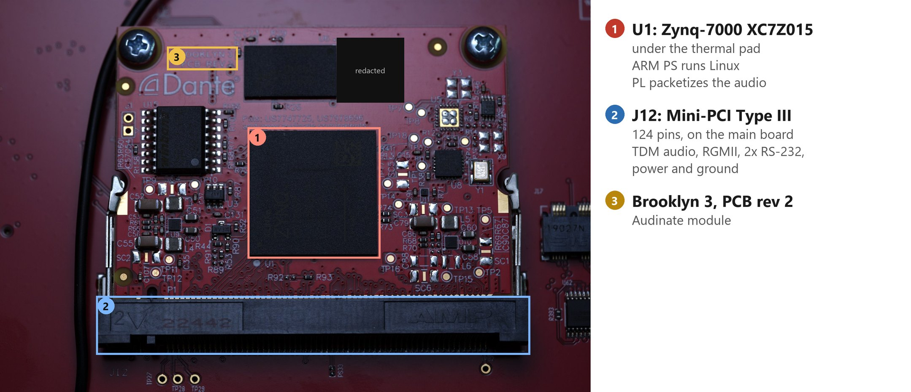
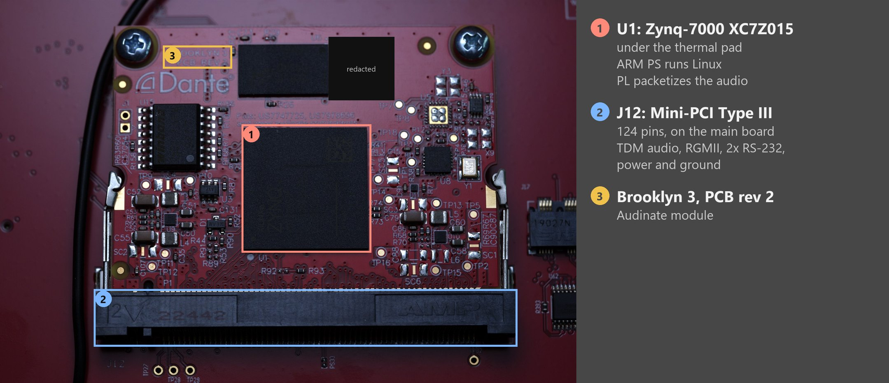
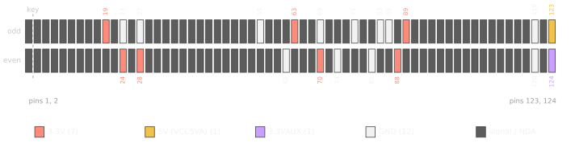

[Part 2](/posts/2026/11/bma360-part-2/) got me a shell on the OMAP, which is half the tile. The audio leaves the main board over a card-edge TDM bus and lands on an Audinate Brooklyn-3 module: a Xilinx Zynq-7000 XC7Z015 with its own QSPI flash. My early notes called the card dark: no console, no way in.

{: .only-light}
{: .only-dark}
*The module's serial label is blacked out.*

The card is on the network
======

The main board and the Brooklyn-3 card share an internal Ethernet link as well as the audio TDM bus. From the OMAP shell, the card's management interface is one subnet away:

```
board$ ip link set eth1 up
board$ ip addr add <card-subnet-ip>/16 dev eth1
board$ ip neigh show
  <card-ip> dev eth1 lladdr <REDACTED-MAC> REACHABLE
board$ ping -c2 <card-ip>
  2 packets transmitted, 2 received, 0% packet loss
board$ busybox nc -w2 <card-ip> 23
  (port 23 open; everything else refused)
board$ busybox telnet <card-ip>
  <hostname> login:
```

A telnet login prompt. The card had only looked dark because I had never brought `eth1` up.

Its own Linux, its own flash
======

On the card is a second Linux system, built by the vendor: kernel 6.6.80 and U-Boot 2019.01 on two of my cards, an older 4.19.36 kernel on the third. U-Boot on the card's UART prints `SecureBoot: enabled`, and the eFuses agree: RSA authentication was burned on at the factory, so the boot ROM only runs a first-stage loader signed with the vendor's key. I can read the card's flash; I can't replace its boot chain.

Its 64 MiB QSPI flash is cut into named partitions, read from the card's `/proc/mtd`:

{: .only-light}
{: .only-dark}
*Measured: `/proc/mtd` on a running card, offsets cross-checked against a second, independently recorded offset table.*

The `safefpga`/`safeboot` pair mirrors the live `fpga`/`boot` pair, the same fallback idea as the OMAP's safe kernel one level down. A Zynq flash driver exposes the partitions as `/dev/flash/<name>` (char major 90, mtdblock major 31). The driver creates those nodes at boot, so searching the rootfs image on disk for `/dev/flash` finds nothing.

The boot stages print to the card's own serial lines. Its device tree marks both `xuartps` ports `u-boot,dm-pre-reloc`, so there is console output from the first boot stage, at 115200:

```
serial0 = /amba/serial@e0000000
serial1 = /amba/serial@e0001000     (both xuartps, both pre-reloc)
```

The physical fallback
======

If the internal link is unavailable, the console is on the card edge. The card is a Mini-PCI Type III module (Amp 1318228-1, 124 pins). The power and ground map is public and is enough to probe safely:

{: .only-light}
{: .only-dark}
*From the module datasheet. The edge also carries 2x RS-232, 4x GPIO, 2x SPI, I2C, 8x SDIN + 8x SDOUT (TDM), RGMII and word clock.*

The RS-232 signal-to-pin assignment is under NDA and I do not have it. The MIO bank's I/O voltage (`VCC_IO`) is undocumented and may be 1.8 V, so measure it before attaching a 3.3 V adapter. To find the console, scope the candidate pins for a line that idles high and bursts at power-up.

What the card changes
======

The Brooklyn-3 supports 64 Dante channels each way. The tile sends eight because the Cyclone on the main board puts eight on its TDM output, so "what are the eight channels?" is a question about the Cyclone's configuration.

On the stock image the Zynq's programmable logic packetizes the audio itself, and the ARM side never sees a sample. The card's Linux is as blind to PCM as the OMAP's. Getting raw samples out through this card means changing what that logic does, inside the limits secure boot sets. Part 8 comes back to it.

{: .only-light}
{: .only-dark}

So there is a shell on both computers in the tile and no audio reachable from either. [Part 4](/posts/2026/11/bma360-part-4/) looks at the remaining obvious route, the vendor application and the Cyclone bitstream.
