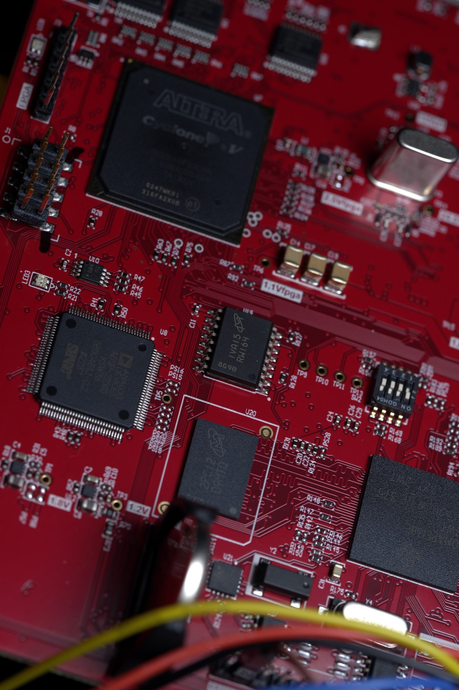
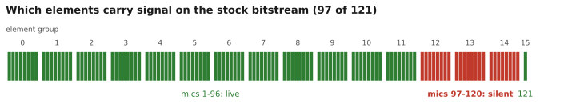
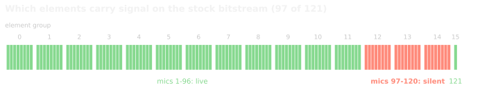

By [Part 3](/posts/2026/11/bma360-part-3/) I had shells on both computers in the tile and still could not read a microphone. The remaining obvious route was the vendor's own application: let `heb_app.bin` run and borrow its access to the FPGA and the DSPs.



The front door: /dev/c1fpga
======

The application reaches the Cyclone through a char device, `/dev/c1fpga` (major 200). The kernel module `c1fpga.ko` maps the FPGA's EMIF chip-select 4 window (physical `0x64000000`) and exposes four ioctls. My first call failed with `EFAULT`, which sent me into the disassembly.

{: .only-light}
{: .only-dark}
*From the `c1fpga.ko` disassembly.*

Grepping the binary for the ioctl numbers finds nothing, because the base is stored negated and a single add does the subtraction:

```c
/* PSEUDOCODE, reconstructed from c1fpga.ko */
long c1fpga_ioctl(struct file *f, unsigned cmd, unsigned long arg) {
    unsigned idx = cmd + 0x3FFB94FF;        /* == cmd - 0xC0046B01 */
    if (idx > 3) return 0;                  /* unknown cmd: silent success */

    void *uptr;
    copy_from_user(&uptr, (void*)arg, 4);   /* arg is a POINTER TO A POINTER */
    if (!uptr) { printk("null data pointer from user"); return -EFAULT; }

    struct c1fpga_reg r;                     /* 12 bytes, not the 4 the _IOC size claims */
    copy_from_user(&r, uptr, (idx == 3) ? 100 : 12);
    u32 off = r.offset & 0xFFFF;             /* BYTE offset into CS4 */
    switch (idx) {
      case 0: r.value = readw(cs4 + off); copy_to_user(uptr,&r,12); break;  /* read  */
      case 2: writew(r.value, cs4 + off); break;                            /* write */
      /* 1 = kernel-log dump, 3 = 16-way bulk write */
    }
}
```

The `EFAULT` came from the argument: it is a pointer to a pointer, and the struct is 12 bytes even though the `_IOC` size field says 4. Once I matched both, my reads lined up with the vendor's own `fpgar` tool:

| path | what you pass | address it hits | `0x22` reaches |
|---|---|---|---|
| my fixed ioctl | 12-byte struct, byte offset | `base + offset` | `0x64000022` yes |
| vendor `fpgar` | full 8-digit address | validated, even-only | `0x64000022` yes |

Reading `0x64000022` returns `0x0117`, the FPGA version. The value is static, so it doubles as an integrity check: if it ever reads anything else, the access path has desynced.

The sweep that found nothing
======

With working reads I swept the CS4 window, 16,128 words read-only from `0x64000200` to `0x64007FFF`, looking for the audio sample FIFOs the app must be reading. There are none. The window holds sixteen 2 KB banks with nearly identical contents:

```
0x64000000  bank 0   registers (version, matrix, meters, DSP control...)
0x64000800  bank 1   same contents, word +0x002 = 0x0010
0x64001000  bank 2   same contents, word +0x002 = 0x0020
   ...      16 banks of 2 KB
0x64007800  bank 15  same contents, word +0x002 = 0x00f0
0x64008000  reads segfault the driver
0x64010000  wraps: read(0x10004) == read(0x004)
```

{: .only-light}
{: .only-dark}
*Measured: read-only sweep, 2026-10-05.*

Across banks 1 to 15, 139 of the 144 register words match exactly. Word `+0x002` echoes the address, `(addr >> 11) << 4`. Word `+0x07E` differs in every bank and looks like a live value. The trio at `+0x088/+0x08C/+0x08E` reads one way in bank 1 and another in banks 2 to 15. Beyond `+0x120` every bank reads `0x0002` fill. My earlier notes described "per-channel routing blocks at `0x64000800 + N*0x800`". A read-only sweep cannot tell sixteen copies of one register file from sixteen identical per-channel blocks; a write to one bank, read back from another, would. What the sweep does settle is the question I came with: there are no audio FIFOs anywhere in the window.

The audio does not pass through any register the OMAP can read. It stays on the TDM buses between the Cyclone, the SHARCs and the Dante card.

![The audio path across the top: 121 MEMS microphones into the Cyclone V, over TDM to the SHARC+ DSPs, then over TDM to the Brooklyn-3 card. Below, the OMAP-L138 reaches only the CS4 register window through /dev/c1fpga: sixteen near-identical 2 KB register banks, version 0x0117 at 0x64000022, and zero audio FIFOs. A side box shows the level meters, read by writing a meter id to 0x90 and reading 0x92, levels only. At the bottom, the Cyclone configures itself from its own SPI NOR flash in Active Serial mode, with Linux outside the configuration path.](/images/bma/tdm-vs-registers-light.svg){: .only-light}
![The audio path across the top: 121 MEMS microphones into the Cyclone V, over TDM to the SHARC+ DSPs, then over TDM to the Brooklyn-3 card. Below, the OMAP-L138 reaches only the CS4 register window through /dev/c1fpga: sixteen near-identical 2 KB register banks, version 0x0117 at 0x64000022, and zero audio FIFOs. A side box shows the level meters, read by writing a meter id to 0x90 and reading 0x92, levels only. At the bottom, the Cyclone configures itself from its own SPI NOR flash in Active Serial mode, with Linux outside the configuration path.](/images/bma/tdm-vs-registers-dark.svg){: .only-dark}

Borrowing the vendor's ears
======

The app also has a metering path: level meters it latches out of the FPGA. Those go through a register, so I can read them too. The read is a write and a read:

```c
/* PSEUDOCODE: the app's own meter read, reusable from a shell tool */
FpgaWrite(0x90, meter->FpgaAddress & 0xFFFF);  /* latch which meter */
FpgaRead (0x92, &word);                         /* read the pair */
u8 raw = (meter->BytePosition == 0) ? (word & 0xFF) : (word >> 8);
int dB  = 20 - (raw >> 1);                       /* -> dBFS, floored at -99 */
```

I played a known sound at the tile and polled the meters:

{: .only-light}
{: .only-dark}
*Measured 2026-10-04, about 20 reads per second.*

The levels move with the sound. That was the first evidence that the microphones and the front end work, gathered with no audio path at all. Levels, no waveform, but it put the problem on egress rather than on a dead sensor.

The bitstream you cannot hold
======

The last vendor route is the Cyclone bitstream itself. Rewriting the FPGA would let me add my own egress. Two findings closed that route for now.

First, the Cyclone configures itself. On power-up it loads its own bitstream from a dedicated SPI flash in Active Serial mode, and Linux is not involved:

```
POWER ON:  Cyclone V --Active Serial--> its own SPI NOR (mt25ql256) --> configured. Linux absent.

UPDATE:    fpgaupdate -> /dev/mt25ql256 (major 155) -> erase/program -> read back (ioctl 0xC0046B0C)
             -> GPIO bit-bang: 127=DCLK, 123=ASDO, 124=DATA0   (3-wire shifter, NO TMS -> not a JTAG TAP)

VERIFY (read-only):  fpgar 0x64000022 -> which bitstream is RUNNING (not what's in flash)
```

{: .only-light}
{: .only-dark}

The aperture they turned off
======

Sweeping the echo-canceller groups and watching which microphones produced signal showed one more thing:

{: .only-light}
{: .only-dark}

Twenty-four of the 121 elements carry nothing on the shipped bitstream. A conference phone does not need them. For an acoustic camera they are 24 elements of aperture switched off in firmware I cannot rewrite yet.

The vendor stack gives register access, level meters, and control of the DSP-load and matrix hardware. It gives no samples, and the bitstream is self-loaded, opaque and behind an unreliable updater. The audio lives on the TDM bus into the SHARC+ DSPs. [Part 5](/posts/2026/11/bma360-part-5/) gets my own code running on one of them.