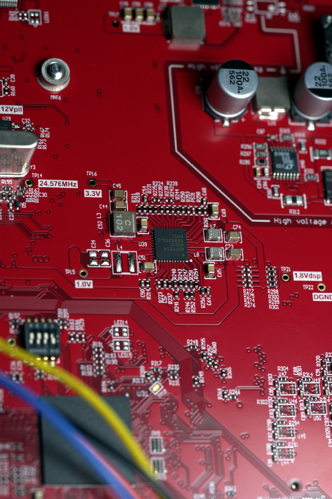

The audio lives on the TDM buses ([Part 4](/posts/2026/11/bma360-part-4/)), and the chips on those buses are the SHARC+ DSPs (ADSP-2156x). If I want samples, I have to run my own code on one. Getting there meant dropping a belief I'd held for weeks.



The DSPs were never dead
======

For a long time my notes said "most DSPs don't come up." That was wrong. When the stock application loads them, every fitted DSP loads, and DSP2 through DSP9 answer the identify exchange with their own index (`…0002…` through `…0009…`). DSP0 answers identify with all zeros, so for DSP0 the check is a version read instead.

What was broken was my hand-driven loader, the one I was poking words with. I blamed the silicon for a bug in my own tooling.

There are ten DSP sites on the board and nine SHARCs in them. Three different images go in:

{: .only-light}
{: .only-dark}

The loader that segfaulted on a string
======

The vendor loader is a Linux program that reads an `.ldr` image and clocks it into a DSP over SPI. The `.ldr` format is simple, a run of 16-byte block headers each followed by its payload:

```
LDR BLOCK HEADER (16 bytes)
  +0  u32  block code (type in low byte: 0x04 final, others init/zero/data)
  +4  u32  target address (DSP memory)
  +8  u32  byte count
  +12 u32  argument / next
```

Run standalone, the loader segfaulted, and the crash had nothing to do with the format. Before it touches a DSP it checks the board: `getPCBAssembly()` returns a board-info string and the loader `strncmp`s it against `"ASY-0514"`. The function reads that string through a pointer that `loadMFGInfo()` is supposed to fill in, and in this code path `loadMFGInfo()` is never called. The pointer stays NULL, `getPCBAssembly()` hands back `0x15e`, and `strncmp` faults on it. No DSP is ever clocked.

The fix is twelve bytes. I replaced the body of `getPCBAssembly()` with "return a pointer to a string that already says ASY-0514":

```
getPCBAssembly @ vaddr 0xe1b8  (file offset 0x61b8)
  ldr  r0, [pc, #0]
  bx   lr
  .word 0x0002699c        ; address of a matching string in the binary
```

The one trap is the mapping. The `PT_LOAD` header maps the file at `+0x8000`, so vaddr `0xe1b8` lives at file offset `0x61b8`. Preloading a shim library instead would have been cleaner, but the board's libc is older than `GLIBC_2.34` and the shim would not load.

{: .only-light}
{: .only-dark}

The register that reads backwards
======

With the gate patched the loader runs to the end, and running to the end is not the same as the DSP taking the image. My first instinct was to clock the image as fast as the bus allows. That gave me DSPs that loaded and then did not identify.

Readiness is one bit per DSP in an FPGA register at CS4 offset `0x10E`, and the sense is inverted: the bit follows the DSP's ready pad, active-low, so **1 means not ready**. On this board it idles at `0x0002`: the one bit that stays high belongs to the empty DSP1 site. The vendor loader logs the register when it times out, and those logs show the bits stuck high:

{: .only-light}
{: .only-dark}

Its neighbour `0x104` is the edge-captured version of the same lines; after the vendor reset it went from `0000` to `03FD`. Once the loader polled the target DSP's bit in `0x10E` and waited for a 0 before every 4-byte word, loads identified every time.

My own loader
======

At that point I dropped the patched vendor binary and wrote `sharcload`. It walks the `.ldr` blocks, polls the ready bit before each word, clocks at 750 kHz in SPI mode 1, then sends the identify frame `00 00 05 02` and checks byte 3 of the 12-byte reply against the DSP index.

{: .only-light}
{: .only-dark}

A full nine-DSP load from empty takes 52 seconds, about 3600 words a second. The soak after it ran identify on DSP2, DSP5 and DSP9 every 15 seconds for eight minutes, with no stock application running, and all 41 checks passed. Later, loading DSP4 on its own took 4 seconds for its 16016 words, which is the mode I use for the hook work below. On array B the all-nine call later started rebooting the main processor, so there I load the DSPs one at a time.

My instructions, executing
======

Loading a vendor image proves the loader. To prove my own code runs I need to change one instruction in a running DSP and watch the result.

DSP4's receive interrupt handler has a load at short-word address `0x1c5544`: `R2 = DM(0x256db8)`. SHARC+ instructions here are three 16-bit parcels, `1002 0025 6db8`, and the first two share one 32-bit memory word, `0x00251002` at `0x2838aa88`. Writing `0x0018063e` there turns the instruction into `JUMP 0x186db8`. The third parcel, `6db8`, stays as it was and becomes the low 16 bits of the jump target, which is why the routine lives at `0x186db8` in free RAM.

![A diagram of the patch. Stock: parcels 1002 0025 6db8, R2 = DM(0x256db8). Patched: 063e 0018 6db8, JUMP sw 0x186db8; one 32-bit word at 0x2838aa88 changes from 00251002 to 0018063e and the third parcel is reused as the target's low 16 bits. The routine at 0x186db8 re-executes the displaced load, does its work using only R0, R2 and I4, and jumps back to 0x1c5547. Measured ISR rate on DSP4: 5999.6 per second stock, about 6000 per second over a 75 s soak with the first counter hook, 6145 to 6231 per one-second read on the lone-DSP4 runs.](/images/bma/p05-isr-patch-light.svg){: .only-light}
![A diagram of the patch. Stock: parcels 1002 0025 6db8, R2 = DM(0x256db8). Patched: 063e 0018 6db8, JUMP sw 0x186db8; one 32-bit word at 0x2838aa88 changes from 00251002 to 0018063e and the third parcel is reused as the target's low 16 bits. The routine at 0x186db8 re-executes the displaced load, does its work using only R0, R2 and I4, and jumps back to 0x1c5547. Measured ISR rate on DSP4: 5999.6 per second stock, about 6000 per second over a 75 s soak with the first counter hook, 6145 to 6231 per one-second read on the lone-DSP4 runs.](/images/bma/p05-isr-patch-dark.svg){: .only-dark}

The routine re-executes the load it displaced, does its own work with registers the vendor's interrupt wrapper already saved, and jumps back to `0x1c5547`, the next stock instruction. The first version just incremented a counter. It ran a 75-second soak with the interrupt rate steady at about 6000 per second, which is what the stock handler does, and writing `0x00251002` back restored the original word.

Then I used the hook to change something I could check from outside. On array A it wrote SPORT0's channel-select word at `0x3100208C` from `00000001` to `001fffff`, read back `001fffff`, and was rolled back to `00000001`. A full nine-DSP reload also resets it to `00000001`.

What I have now
======

I can load any of the DSPs with my own loader, check the load, and run my own instructions inside a live interrupt and take them out again. I do not have a microphone sample yet. Getting one frame of audio out of DSP4's receive ring, and the index register that gave me wrong numbers for a week while I did it, is [Part 6](/posts/2026/11/bma360-part-6/).
